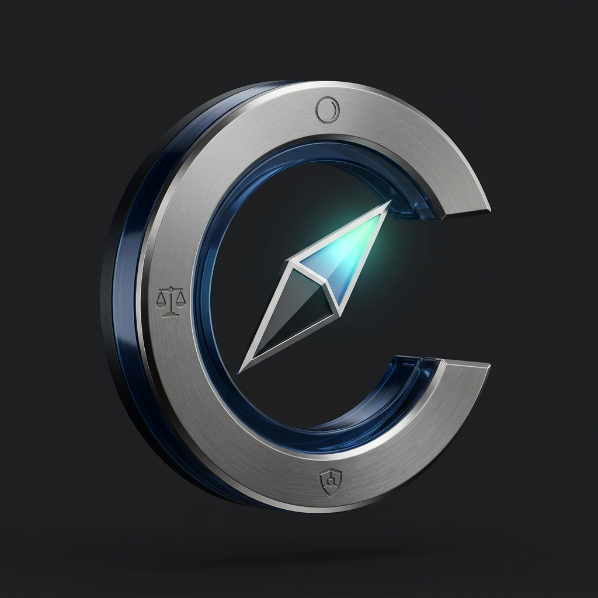

# Cadran - Persönliche Finanz- & Vermögensverwaltung

<p align="center">
  <strong>Sprachen:</strong>
  <a href="README.md">English</a> |
  <a href="README.fr.md">Français</a> |
  <a href="README.es.md">Español</a> |
  <strong>Deutsch</strong>
</p>

<p align="center">
  
  <br/>
  <a href="https://ko-fi.com/curvecoder"></a>
</p>

<p align="center">
  <strong>Eine moderne, lokale und datenschutzorientierte Plattform für persönliche Finanzen, Budgetierung und Vermögensverwaltung.</strong>
  <br/>
  Entwickelt mit ASP.NET Core 9, C# 12, Entity Framework Core und verschlüsseltem SQLite (SQLCipher).
</p>

---

## Dokumentation

- 🗺️ **[Visuelle Schritt-für-Schritt-Anleitung (docs/README.md)](docs/README.md)**: Interaktives Handbuch mit hochauflösenden Screenshots, nummerierten Aktionsaufrufen und Schritt-für-Schritt-Anleitungen für alle 24 Bildschirme in den 6 Funktionsmodulen.
- 📖 **[Benutzerhandbuch & Betrieb (docs/de/user-guide.md)](docs/de/user-guide.md)**: Umfassendes Handbuch mit Schnellstart, Schritt-für-Schritt-Anleitungen, Windows Tray Supervisor, Windows Service (NSSM), Linux Standalone-Binary, Linux Bereitstellungsarchiv (`.tar.gz`), `systemd`-Integration, isolierten Offline-Installationen (Air-Gap) und Finanzkonzepten.
- 🏗️ **[Architektur- & Engineering-Spezifikation (docs/de/architecture.md)](docs/de/architecture.md)**: Detaillierte technische Referenz über Komponentenarchitektur, entkoppelte Shared Frameworks (`StatementForge`, `SqliteForge`, `LocaleForge`, `FileForge`), Nebenläufigkeits- und Speichermodelle sowie zweistufige Sicherheit.

---

## Warum Cadran?

Die meisten persönlichen Finanzanwendungen erfordern die Weitergabe Ihrer Bankzugangsdaten an Cloud-Aggregatoren, wodurch vertrauliche Transaktionen an Dritte übermittelt werden, oder setzen auf kostenpflichtige Cloud-Abodienste, die eingestellt werden oder Datenlecks erleiden können.

**Cadran basiert auf entgegengesetzten Grundprinzipien:**
1. **Echte lokale Datensouveränität (Local-First)**: Alle Transaktionen, Bankkonten, Kategorien und Regeln verbleiben lokal in einer einzigen SQLite-Datenbank (`cadran.db`). Keine Finanzdaten verlassen Ihr System.
2. **Keine Remote-Scraper oder Drittanbieter-Aggregatoren**: Behalten Sie die vollständige Kontrolle über Ihre Bankdaten, indem Sie Standard-**OFX**-, **QFX**- oder **CSV**-Kontoauszüge direkt von Ihrer Bank importieren.
3. **Mandantenfähige Benutzerisolation**: Betreiben Sie mehrere getrennte Bereiche auf derselben Instanz (Familienmitglieder oder geschäftlich vs. privat) mit separaten Kontenbüchern, Regeln und Dashboards.
4. **Zweistufige Sicherheit**: Kontoschutz durch Passwort-Hashing kombiniert mit optionaler hardwareunabhängiger Verschlüsselung im Ruhezustand (**AES-256 / SQLCipher**). Für den Fernzugriff wird ein privates VPN (wie WireGuard) empfohlen.
5. **100 % offline & luftspaltfähig (Air-Gapped)**: Sämtliche Web-Assets, Symbole, Schriftarten und Skripte sind lokal eingebettet. Keine CDNs, Tracking-Pixel oder Internetverbindungen erforderlich.

---

## Hauptfunktionen

| Bereich | Leistungsmerkmale |
|---|---|
| **Vermögen & Konten** | Konsolidierte Nettovermögensübersicht (Liquide Mittel, Ersparnisse & Anlagen, Schulden / Überziehung), 16 vorkonfigurierte Kontotypen sowie anpassbare Status, Mehrwährungsunterstützung (EUR, USD, GBP, CHF, CAD usw.). |
| **Kontoauszug-Import & Deduplizierung** | Effizienter Import von **OFX / QFX** (automatische Kontozuordnung via `<ACCTID>`) und konfigurierbaren **CSV**-Dateien (wiederverwendbare Zuordnungsprofile). Strikte Duplikaterkennung und interaktiver Abgleich bei Fuzzy-Matches. |
| **Buchungsjournal & Split-Buchungen** | Sofortige Multikriterien-Suche, Aufteilung von Transaktionen auf mehrere Kategorien und Zahlungsempfänger, Budgetverschiebungen (Zuordnung von Monatsendgehältern auf M+1) und Sammelabstimmung. |
| **Kategorien & Zahlungsempfänger** | Zweistufige Hierarchie (Haupt- und Unterkategorien), Klassifizierung in Einnahme / Ausgabe / Gehalt, native Zweisprachigkeit (Englisch / Französisch) und Normalisierung von Händlernamen. |
| **Regelwerk für Automatisierungen** | Prioritätsgesteuerte Kategorisierungsregeln mit Platzhaltern (`*`, `%`, `?`) oder regulären Ausdrücken, Konto- und Betragsfilter, automatische Zuweisung von Zahlungsempfängern und rückwirkende Anwendung. |
| **Wiederkehrende Ausgaben & Verfügbares Budget** | Automatische Erkennung von Abonnements und regelmäßigen Rechnungen mit Zuverlässigkeitsbewertung, Statusverfolgung (Abgebucht, Ausstehend, Überfällig) und dynamische Prognose des **Verfügbaren Budgets** (*Safe-to-Spend*). |
| **Dashboards & Pivot-Tabellen** | Anpassbare visuelle Widgets (Diagramme, Balken, KPIs) und interaktive mehrdimensionale **Pivot-Tabellen** mit detailliertem Buchungs-Drilldown und CSV-Export. |
| **Erscheinungsbild & Komfort** | Native zweisprachige Oberfläche (Englisch / Französisch), stufenlose Schriftgrößenanpassung mit Live-Vorschau, Tabellenmodi *Kompakt* vs. *Komfort* und anpassbarer Starttag des Budgetzyklus. |

---

## Schnellstart

### 1. Windows-Desktop (System-Tray-Supervisor)

Cadran enthält einen nativen Windows-Desktop-Supervisor (`Cadran.Launcher.exe`) im Infobereich:
- Steuert den Lebenszyklus des Kestrel-Webservers.
- Öffnet Ihren Standardbrowser mit einem Klick auf `http://localhost:5000`.
- Erstellt beim Start und beim Beenden automatisch Backups mit Zeitstempel in `app/backups/`.

```powershell
# Aus dem Quellcode starten
dotnet run --project Cadran.Launcher/Cadran.Launcher.csproj

# Oder eigenständiges Verteilungspaket erstellen
./scripts/publish-windows.ps1
```

### 2. Linux Standalone-Einzeldatei (`Cadran-*-linux-x64`)

**Wann wählen:** Ideal für schnelle Tests, persönliche Entwicklerrechner, portable Skripte oder Ad-hoc-Server. Es handelt sich um eine eigenständige ausführbare Datei ohne Entpackungsvorgang, die die vollständige .NET 9-Laufzeitumgebung und die SQLCipher-Engine enthält.

```bash
# 1. Release-Binary herunterladen und Ausführungsrechte vergeben
chmod +x Cadran-1.0.0-linux-x64

# 2. Direkt starten (erstellt beim ersten Start automatisch ./data/cadran.db)
./Cadran-1.0.0-linux-x64 --urls http://0.0.0.0:5000

# 3. Weboberfläche aufrufen
xdg-open http://localhost:5000 # oder http://<server-ip>:5000 im Browser öffnen
```

### 3. Linux Bereitstellungsarchiv (`Cadran-*-linux-x64.tar.gz`) & `systemd`

**Wann wählen:** Empfohlen für Produktions- und Heimserver sowie den dauerhaften Hintergrundbetrieb unter einem unprivilegierten Systembenutzer. Das Archiv entpackt sich in ein standardisiertes Layout (`/opt/cadran`) mit vorbereiteten Verzeichnissen `data/` und `backups/`.

```bash
# 1. Dedizierten unprivilegierten Systembenutzer erstellen
sudo useradd --system --shell /usr/sbin/nologin --home-dir /opt/cadran cadran
sudo mkdir -p /opt/cadran
sudo chown -R cadran:cadran /opt/cadran

# 2. Distributionsarchiv entpacken
sudo tar -xzf Cadran-1.0.0-linux-x64.tar.gz -C /opt/cadran
sudo chown -R cadran:cadran /opt/cadran
sudo chmod +x /opt/cadran/Cadran

# 3. Direkt starten oder als abgesicherten systemd-Dienst einrichten
sudo -u cadran /opt/cadran/Cadran --urls http://0.0.0.0:5000
```
*(Siehe [Produktionsbetrieb](docs/de/user-guide.md#33-running-on-linux-production-deployments) für die vollständige gehärtete systemd-Service-Unit und den automatischen Systemstart).*

---

## Architektur & Shared Frameworks

`Cadran` basiert auf modularen wiederverwendbaren Bibliotheken des `curvecoder`-Ökosystems, die den Clean-Architecture-Vorgaben entsprechen und über SonarQube Quality Gates validiert sind:

- **[StatementForge](https://github.com/curvecoder/StatementForge)** (`v1.0.0`): Performanter Streaming-Bankauszugs-Parser (OFX, QFX, CSV) mit Transaktions-Deduplizierung, konfigurierbaren CSV-Profilen und Erkennung wiederkehrender Ausgaben.
- **[SqliteForge](https://github.com/curvecoder/SqliteForge)** (`v1.0.0`): Ausfallsichere SQLite-Infrastruktur mit automatischer WAL-Parallelitätssteuerung, AES-256-Verschlüsselung (SQLCipher/SQLiteMC) und dynamischen Konfigurationsprovidern.
- **[LocaleForge](https://github.com/curvecoder/LocaleForge)** (`v1.0.0`): Schlanke hierarchische JSON-Lokalisierungsbibliothek und ISO-4217-Währungsformatierer.

Alle Abhängigkeiten werden automatisch über NuGet aus GitHub Packages mit der beiliegenden `nuget.config` geladen.

Um die vollständige Qualitätsprüfung auszuführen (Formatierung, Release-Build, Unit- und Architekturtests mit OpenCover-Abdeckung sowie SonarQube Quality Gate):
```powershell
.\verify.ps1
```

---

## Support & Sponsoring

Cadran ist kostenlos, Open Source und unabhängig entwickelt. Wenn Cadran Ihnen hilft, Ihre Finanzen zu verwalten und Ihre Datensouveränität zu schützen, können Sie die Weiterentwicklung unterstützen:

[](https://ko-fi.com/curvecoder)

Ihre Beiträge fließen direkt in die laufende Pflege, Performance-Optimierungen und Open-Source-Infrastruktur.

---

## Lizenz

Dieses Projekt ist lizenziert unter der [MIT License](LICENSE) &copy; 2026 curvecoder.
