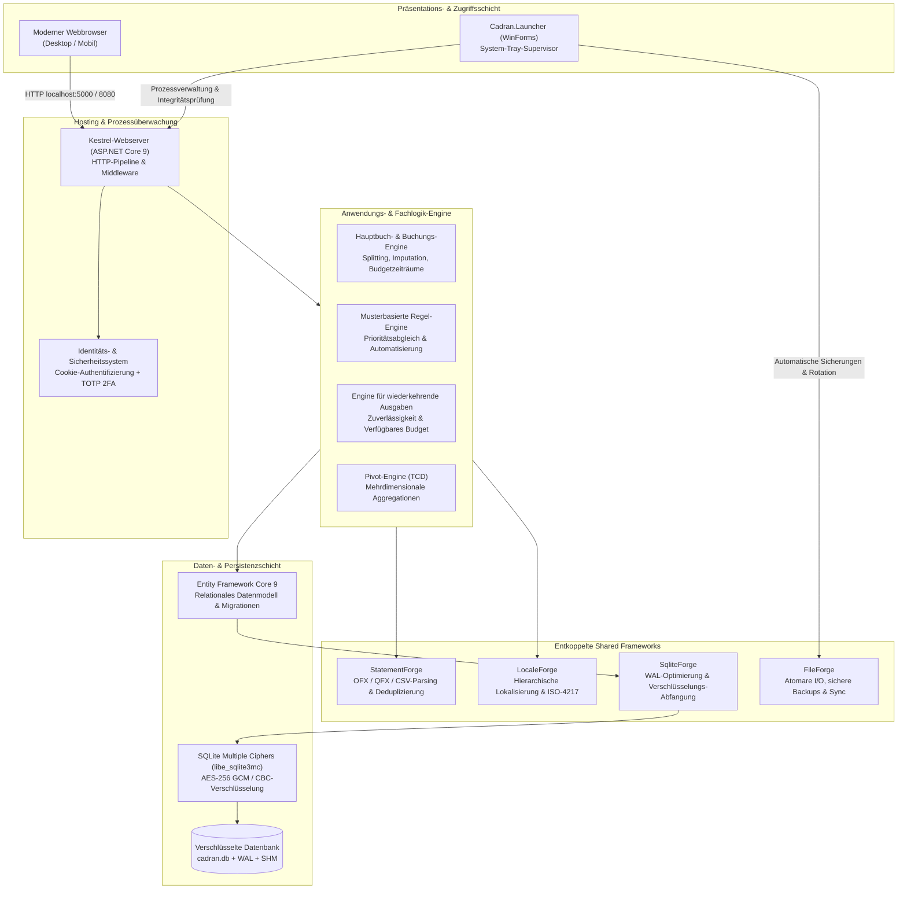
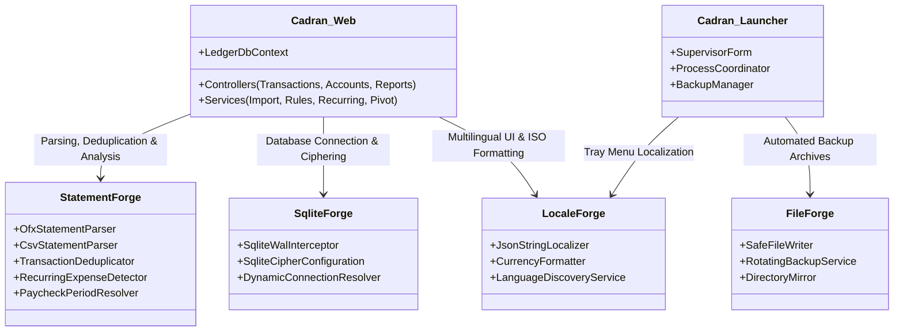
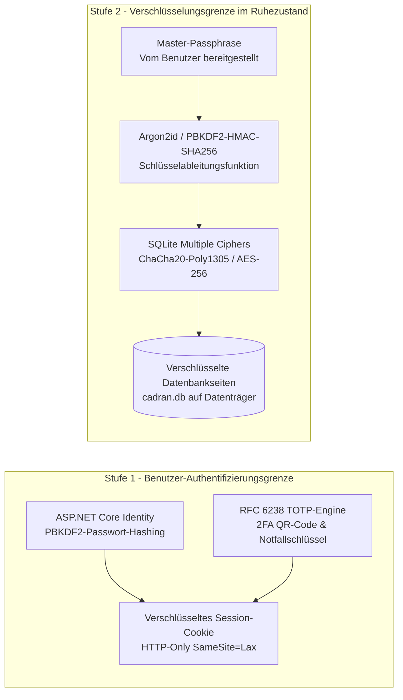

# Cadran - Architektur- & Engineering-Spezifikation

  <strong>Sprachen:</strong>
  <a href="../architecture.md">English</a> |
  <a href="../fr/architecture.md">Français</a> |
  <a href="../es/architecture.md">Español</a> |
  <strong>Deutsch</strong>

## 1. Zusammenfassung der Architektur

**Cadran** ist eine hochperformante, lokale und datenschutzorientierte Plattform für persönliche Finanzen und Vermögensverwaltung, basierend auf ASP.NET Core 9 und modernem C# 12. Konsequent nach den Paradigmen **Local-First** und **Privacy-First** konzipiert, arbeitet Cadran vollständig autark ohne Cloud-Aggregationsdienste, Remote-Telemetrie oder Drittanbieter-Analysen.

Die Plattform besteht im Kern aus zwei Binärdateien:
1. **Cadran (Webserver-Engine)**: Eine ASP.NET Core 9-Anwendung mit reaktiver Weboberfläche, Fachlogik-Engine, transaktionalem Buchungsjournal und einer verschlüsselten SQLite-Speicherschicht.
2. **Cadran.Launcher (Windows-Supervisor)**: Ein schlankes Hilfsprogramm für den Windows-Infobereich, das den Lebenszyklus des Webservers überwacht, automatisierte Sicherungen beim Start und Beenden verwaltet und den Standard-Webbrowser öffnet.

---

## 2. Architektur der entkoppelten Shared Frameworks

Cadran folgt den Prinzipien der Clean Architecture und der Dependency Inversion. Fachdomäne, Parsing, Speicherung und Lokalisierung nutzen wiederverwendbare modulare Bibliotheken aus dem `curvecoder`-Ökosystem:

### 2.1. Aufgaben der Frameworks
- **StatementForge**: Bietet performante Streaming-Parser für Open Financial Exchange (OFX 1.x und 2.x), Quicken Financial Exchange (QFX) und anpassbare getrennte Formate (CSV/TSV). Implementiert Fuzzy-Matching-Algorithmen zur Duplikatbereinigung und berechnet Frequenzmuster wiederkehrender Ausgaben.
- **SqliteForge**: Konfiguriert native SQLite-Parameter, aktiviert Write-Ahead-Logging (`PRAGMA journal_mode=WAL`), erzwingt relationale Integrität (`PRAGMA foreign_keys=ON`) und bindet `libe_sqlite3mc` für die Passphrasen-Verschlüsselung an ASP.NET Core an.
- **LocaleForge**: Liefert reflexionsfreie, hierarchische JSON-String-Lokalisierung für vollständige Zweisprachigkeit (`en-US` und `fr-FR`), gekoppelt mit ISO-4217-Währungsformatierung über alle Konten hinweg.
- **FileForge**: Verantwortlich für atomare Dateisystemoperationen, rollierende zeitgestempelte Zip-Sicherungen und absturzsichere Speicherschreibvorgänge.

---

## 3. Speicher-, Verschlüsselungs- & Sicherheitsarchitektur

### 3.1. Zweistufiges Sicherheitsmodell
Cadran trennt Daten und Authentifizierung über zwei unabhängige Schutzgrenzen:

1. **Benutzer-Authentifizierung (Stufe 1)**:
   - Jeder registrierte Benutzer verfügt über einen isolierten Bereich (`UserId`).
   - Passwörter werden mit ASP.NET Core Identity PBKDF2 und kryptografischen Salts geschützt.
   - **TOTP Zwei-Faktor-Authentifizierung (Nicht getestet / Geplante Entfernung)**: Die zeitbasierte Einmalpasswort-Authentifizierung (TOTP) wurde ursprünglich mit Offline-Wiederherstellungsschlüsseln implementiert. Eine direkte Veröffentlichung von Cadran im offenen Internet wird jedoch nicht empfohlen. Da Cadran für den lokalen Betrieb oder innerhalb eines geschützten Heimnetzwerks konzipiert ist, ist TOTP 2FA **nicht getestet und wird in einer künftigen Version entfernt**. Benutzer, die Fernzugriff benötigen, sollten sich über ein privates VPN (wie WireGuard) verbinden, anstatt Ports ins Internet weiterzuleiten.
2. **Datenbankverschlüsselung im Ruhezustand (Stufe 2)**:
   - Optionale vollständige Verschlüsselung auf Datenbankebene mittels **SQLite Multiple Ciphers (SQLCipher / AES-256)**.
   - Im aktivierten Zustand sind Rohdaten auf der Festplatte ohne den Master-Schlüssel unlesbar.
   - Die transparente In-Memory-Entschlüsselung übernimmt `libe_sqlite3mc` direkt auf C-Laufzeitebene, ohne unverschlüsselte Zwischendateien anzulegen.

### 3.2. SQLite-Parallelität & WAL-Modus
- Der Verbindungspool nutzt `journal_mode=WAL` (Write-Ahead Logging) und `synchronous=NORMAL`.
- Leser blockieren niemals Schreiber, und Schreiber blockieren niemals Leser.
- Hintergrund-Checkpoints überführen protokollierte Daten aus `-wal` und `-shm` regelmäßig in `cadran.db`, um ein unkontrolliertes Anwachsen der Logdateien zu verhindern.

---

## 4. Threading-Modell & Speicherverwaltung

### 4.1. Asynchrone I/O-Pipeline
- Alle Controller-Aktionen und EF Core-Abfragen nutzen kooperative `async/await`-Muster mit konsequenter Weitergabe von `CancellationToken`.
- HTTP-Anfragen werden über den .NET-Thread-Pool verarbeitet, ohne synchrone Blockaden (`.Result` oder `.Wait()` sind strikt untersagt).

### 4.2. Speicherallokation & Garbage Collection
- Das Parsen von Kontoauszügen (OFX/CSV) nutzt speicherabgebildete Streams und `Span<T>` / `ReadOnlySpan<char>`, um eine Fragmentierung des Large Object Heap (LOH) zu vermeiden.
- Aggregationsabfragen in Pivot-Tabellen (TCD) verwenden direkte Datenbank-Streaming-Projektionen (`Select`), um große Entitätsmengen nicht in den Arbeitsspeicher zu laden.
- Der Server arbeitet sehr ressourcenschonend (üblicherweise unter **90 MB** privater Arbeitssatz bei stabiler Last).

---

## 5. Performance & Benchmarks

| Metrik | Zielwert | Beobachtet |
|---|---|---|
| **Kaltstart des Servers** | < 1,5 Sekunden | ~ 850 ms (Release x64) |
| **OFX-Import (10.000 Buchungen)** | < 1,0 Sekunde | ~ 320 ms |
| **Regelausführungs-Engine (5.000 Regeln)** | < 100 ms | ~ 35 ms |
| **Pivot-Tabellen-Aggregation (50.000 Buchungen)** | < 250 ms | ~ 95 ms |
| **Standalone-Binary-Dateigröße** | < 150 MB | ~ 100 MB (Self-contained x64) |
