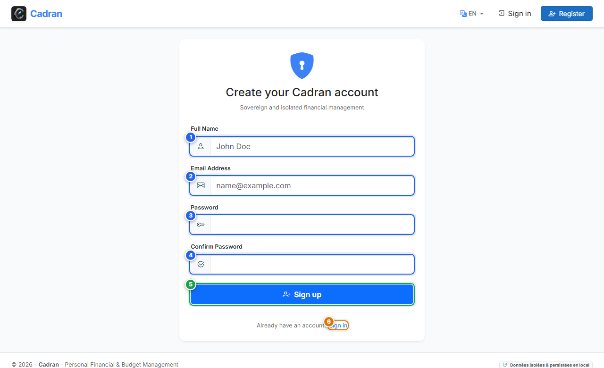

# Benutzerhandbuch: Kontoregistrierung

[← Zurück: 01 - Willkommensbildschirm](01-welcome.md) | [Zurück zum Hauptindex](../README.md) | [Weiter: 03 - Anmeldung →](03-login.md)

---

Der Bildschirm **Kontoregistrierung** richtet Ihr persönliches Benutzerprofil in Cadran ein. Nach Abschluss initialisiert Cadran automatisch einen Standardkatalog von Einnahmen- und Ausgabenkategorien für Ihren Arbeitsbereich.

---

## 1. Visuelle Übersicht & Aktionsmarkierungen

---

## 2. Referenztabelle der Aktionen

| Markierung | Bedienelement | Aktionstyp | Handlungsanweisung |
| :---: | :--- | :---: | :--- |
| <kbd>1</kbd> | **Vollständiger Name** | **AUSFÜLLEN** | Geben Sie Ihren Anzeigenamen oder vollen Namen ein (z. B. `Alice`). |
| <kbd>2</kbd> | **E-Mail-Adresse** | **AUSFÜLLEN** | Geben Sie Ihre E-Mail-Adresse ein, die als Benutzername für die Anmeldung dient. |
| <kbd>3</kbd> | **Passwort** | **AUSFÜLLEN** | Wählen Sie ein sicheres Passwort (mindestens 8 Zeichen). |
| <kbd>4</kbd> | **Passwort bestätigen** | **AUSFÜLLEN** | Geben Sie das Passwort zur Bestätigung erneut exakt ein. |
| <kbd>5</kbd> | **Schaltfläche "Registrieren"** | **HIER KLICKEN** | Klicken Sie auf diese Schaltfläche, um Ihr Konto zu erstellen und loszulegen. |
| <kbd>6</kbd> | **Link "Anmelden"** | **HIER KLICKEN** | Klicken Sie auf diesen Link, falls Sie bereits ein Konto besitzen, um zum Anmeldeformular zu wechseln. |

---

## 3. Schritt-für-Schritt-Anleitung

1. **Benutzerdaten eingeben**:
   - Klicken Sie in das Feld **Vollständiger Name** (**[1]**) und geben Sie Ihren Namen ein.
   - Klicken Sie in das Feld **E-Mail-Adresse** (**[2]**) und tragen Sie Ihre E-Mail ein.
2. **Passwort festlegen**:
   - Geben Sie Ihr geheimes Passwort in das Feld **Passwort** (**[3]**) ein.
   - Wiederholen Sie es im Feld **Passwort bestätigen** (**[4]**).
3. **Abschließen**:
   - Klicken Sie auf die blaue Schaltfläche **Registrieren** (**[5]**).
   - Sie werden automatisch angemeldet und direkt zur Kontenübersicht weitergeleitet.
