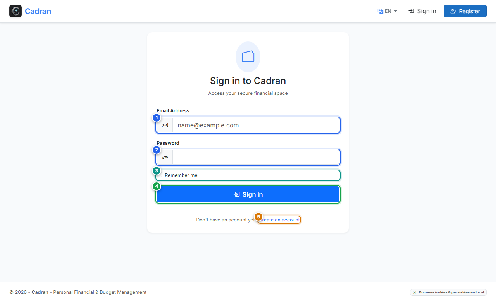

# Benutzerhandbuch: Anmeldung & Authentifizierung

[← Zurück: 02 - Kontoregistrierung](02-register.md) | [Zurück zum Hauptindex](../README.md) | [Weiter: 04 - Datenbank-Verschlüsselung →](04-database-encryption.md)

---

Der Bildschirm **Anmeldung** prüft Ihre Zugangsdaten und öffnet Ihren persönlichen Finanzbereich in Cadran.

---

## 1. Visuelle Übersicht & Aktionsmarkierungen

---

## 2. Referenztabelle der Aktionen

| Markierung | Bedienelement | Aktionstyp | Handlungsanweisung |
| :---: | :--- | :---: | :--- |
| <kbd>1</kbd> | **E-Mail-Adresse** | **AUSFÜLLEN** | Tragen Sie Ihre registrierte E-Mail-Adresse ein. |
| <kbd>2</kbd> | **Passwort** | **AUSFÜLLEN** | Geben Sie Ihr Passwort ein. Die Zeichen werden aus Datenschutzgründen maskiert. |
| <kbd>3</kbd> | **Angemeldet bleiben** | **OPTIONAL** | Aktivieren Sie dieses Kontrollkästchen auf Ihrem persönlichen PC, um die Sitzung beizubehalten. |
| <kbd>4</kbd> | **Schaltfläche "Anmelden"** | **HIER KLICKEN** | Klicken Sie hier, um Ihre Anmeldedaten zu prüfen und das Dashboard aufzurufen. |
| <kbd>5</kbd> | **Link "Konto erstellen"** | **HIER KLICKEN** | Klicken Sie auf diesen Link, falls Sie noch kein Konto haben, um zum Registrierungsformular zu wechseln. |

---

## 3. Schritt-für-Schritt-Anleitung

1. **Zugangsdaten eingeben**:
   - Geben Sie Ihre E-Mail im Feld **E-Mail-Adresse** (**[1]**) ein.
   - Tragen Sie Ihr Passwort im Feld **Passwort** (**[2]**) ein.
2. **Sitzungsoptionen**:
   - Setzen Sie ein Häkchen bei **Angemeldet bleiben** (**[3]**), wenn es sich um Ihren privaten PC handelt.
3. **Anmelden**:
   - Klicken Sie auf die blaue Schaltfläche **Anmelden** (**[4]**) oder drücken Sie die Taste <kbd>Enter</kbd>.
