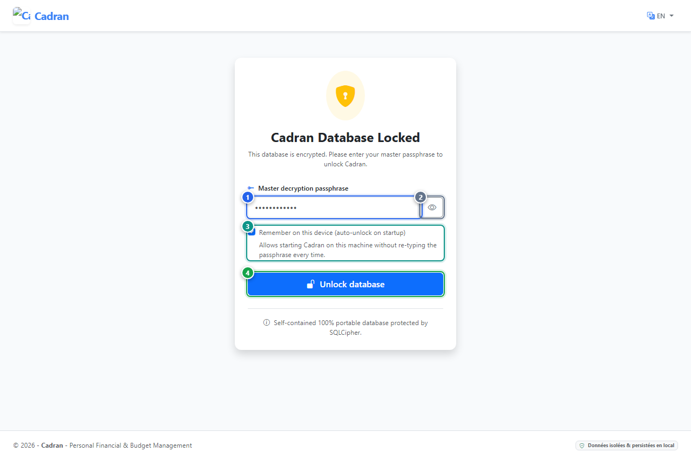

# Benutzerhandbuch: Datenbankentsperrung

[← Zurück: 04 - Datenbank-Verschlüsselung](04-database-encryption.md) | [Zurück zum Hauptindex](../README.md) | [Weiter: 06 - Dashboard →](06-dashboard.md)

---

Der Bildschirm **Datenbankentsperrung** erscheint beim Start von Cadran, wenn die Datenbankverschlüsselung aktiv ist und das automatische Entsperren auf diesem Gerät nicht ausgewählt wurde. Sie müssen Ihre Master-Passphrase eingeben, um Ihren Arbeitsbereich freizuschalten.

---

## 1. Visuelle Übersicht & Aktionsmarkierungen

---

## 2. Referenztabelle der Aktionen

| Markierung | Bedienelement | Aktionstyp | Handlungsanweisung |
| :---: | :--- | :---: | :--- |
| <kbd>1</kbd> | **Master-Passphrase** | **AUSFÜLLEN** | Geben Sie Ihre geheime Entschlüsselungs-Passphrase in dieses Feld ein. |
| <kbd>2</kbd> | **Symbol Einblenden / Ausblenden** | **HIER KLICKEN** | Klicken Sie auf das Augensymbol, um die eingegebenen Zeichen anzuzeigen oder zu verbergen. |
| <kbd>3</kbd> | **Auf diesem Gerät merken** | **OPTIONAL** | Aktivieren Sie dieses Feld, damit dieser Rechner den Schlüssel speichert und beim nächsten Mal direkt startet. |
| <kbd>4</kbd> | **Schaltfläche "Datenbank entsperren"** | **HIER KLICKEN** | Klicken Sie hier, um Cadran zu entschlüsseln und Ihre Konten aufzurufen. |

---

## 3. Schritt-für-Schritt-Anleitung

1. **Passphrase eingeben**:
   - Klicken Sie in das Feld **Master-Entschlüsselungspassphrase** (**[1]**) und geben Sie Ihren Schlüssel ein.
2. **Eingabe prüfen (Optional)**:
   - Klicken Sie auf das Augensymbol (**[2]**), um eventuelle Tippfehler auszuschließen.
3. **Zukünftiges Startverhalten**:
   - Aktivieren Sie **Auf diesem Gerät merken** (**[3]**), um eine wiederholte Passworteingabe künftig zu vermeiden.
4. **Entsperren**:
   - Klicken Sie auf die blaue Schaltfläche **Datenbank entsperren** (**[4]**) oder drücken Sie <kbd>Enter</kbd>.
   - Sie gelangen unmittelbar zur Kontenübersicht.
