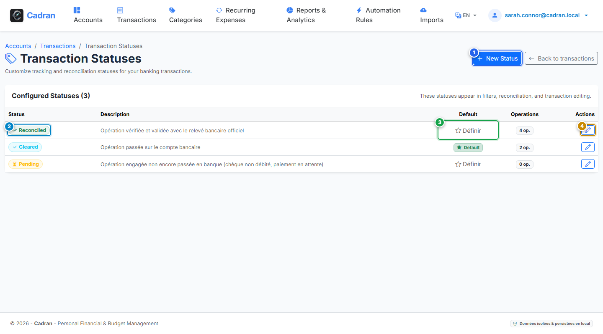

# Benutzerhandbuch: Benutzerdefinierte Buchungsstatus & Abstimmung

[← Zurück zu Kontotypen](10-account-types.md) | [Zurück zum Hauptindex](../README.md)

---

Der Bildschirm **Buchungsstatus** erlaubt die Konfiguration des Abstimmungs- und Freigabeworkflows. Status begleiten Buchungen über ihren gesamten Lebenszyklus: zur Prüfung ausstehend, von der Bank verbucht, mit dem offiziellen Kontoauszug abgestimmt oder beanstandet.

---

## 1. Visuelle Übersicht & Aktionsmarkierungen

---

## 2. Referenztabelle der Aktionen

| Markierung | Bedienelement | Aktionstyp | Handlungsanweisung |
| :---: | :--- | :---: | :--- |
| <kbd>1</kbd> | **Schaltfläche "Neuer Status"** | **HIER KLICKEN** | Klicken Sie hier, um einen neuen Buchungsstatus anzulegen (z. B. `In Klärung`, `Zu prüfen`). |
| <kbd>2</kbd> | **Status-Badge** | **AUSWÄHLEN** | Prüfen Sie die visuelle Darstellung (Symbol und Farbe) für das Buchungsjournal. |
| <kbd>3</kbd> | **Standardstatus-Indikator** | **AUSWÄHLEN** | Zeigt den Status an, der neu importierten Buchungen automatisch zugewiesen wird. |
| <kbd>4</kbd> | **Schaltfläche "Bearbeiten"** | **HIER KLICKEN** | Klicken Sie hier, um Name, Farbe, Symbol oder die Standard-Eigenschaft zu ändern. |

---

## 3. Empfohlener Abstimmungs-Workflow

Ein praxiserprobter Finanz-Workflow gliedert sich in drei Schritte:

1. **Ausstehend**: Ein Vorgang wurde angewiesen oder getätigt (z. B. Scheck, vorgemerkte Kartenzahlung), ist aber noch nicht auf dem Bankauszug sichtbar.
2. **Verbucht**: Die Transaktion wird im Online-Banking mit festem Buchungsdatum und Betrag geführt.
3. **Abgestimmt**: Die Buchung wurde anhand des monatlichen Original-Kontoauszugs (PDF) final gegengeprüft.

---

## 4. Schritt-für-Schritt-Anleitung

1. **Benutzerdefinierten Status erstellen**:
   - Klicken Sie oben rechts auf **Neuer Status** (<kbd>1</kbd>).
   - Geben Sie einen Namen ein (z. B. `Zu prüfen`), wählen Sie Symbol und Farbe und legen Sie fest, ob dies der Standard bei neuen Importen sein soll.
2. **Bestehende Status anpassen**:
   - Klicken Sie auf die Stift-Schaltfläche **Bearbeiten** (<kbd>4</kbd>) in der gewünschten Zeile.
3. **Neuen Import-Standardstatus festlegen**:
   - Bearbeiten Sie den gewünschten Status und aktivieren Sie **Standardstatus** (<kbd>3</kbd>).
