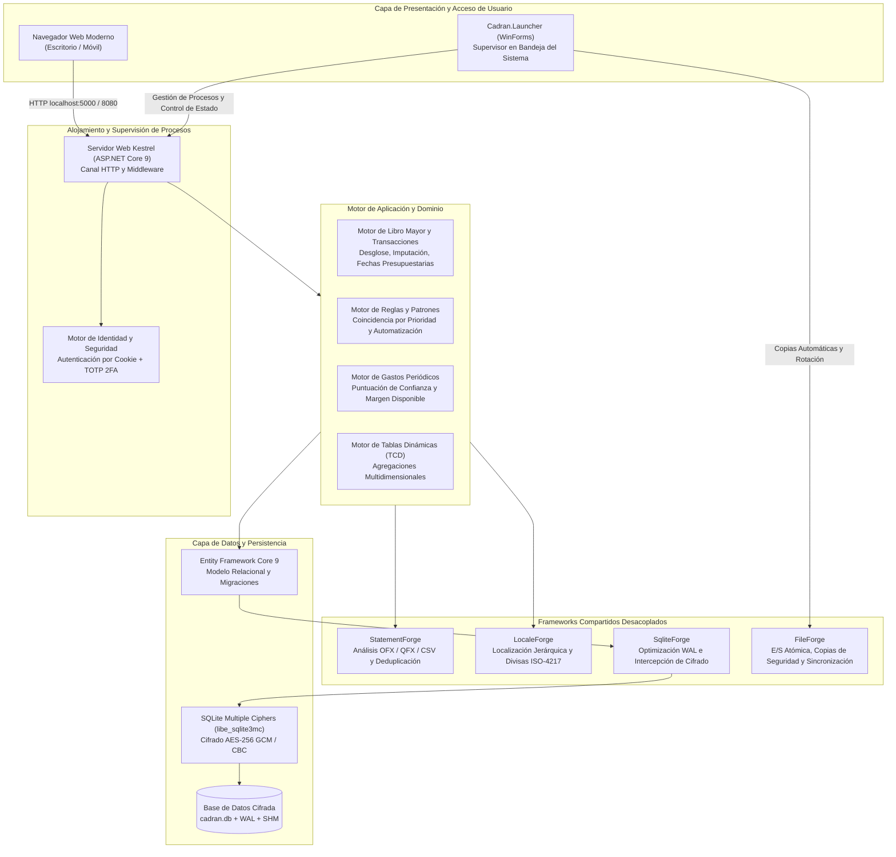
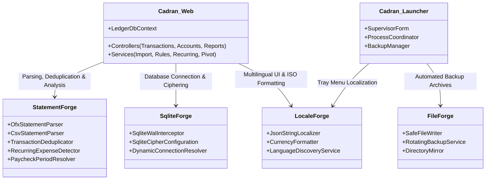
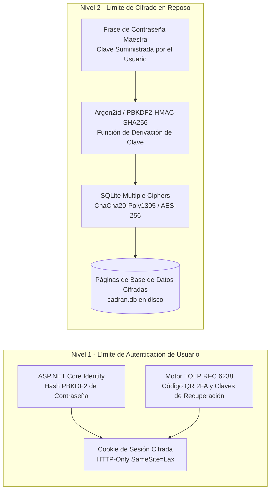

# Cadran - Especificación de Arquitectura e Ingeniería

  <strong>Idiomas:</strong>
  <a href="../architecture.md">English</a> |
  <a href="../fr/architecture.md">Français</a> |
  <strong>Español</strong> |
  <a href="../de/architecture.md">Deutsch</a>

## 1. Resumen Ejecutivo de la Arquitectura

**Cadran** es una plataforma de alto rendimiento de finanzas personales y gestión patrimonial, diseñada para operar localmente y con estricto respeto a la privacidad, construida sobre ASP.NET Core 9 y C# 12. Diseñada bajo los paradigmas **Local-First** y **Privacy-First**, Cadran funciona de forma completamente autónoma sin servicios de agregación en la nube, telemetría remota ni analítica de terceros.

La plataforma está estructurada en torno a dos binarios principales:
1. **Cadran (Motor Servidor Web)**: Una aplicación ASP.NET Core 9 que aloja una interfaz web interactiva, el motor de dominio empresarial, el libro mayor transaccional y una capa de almacenamiento SQLite cifrada.
2. **Cadran.Launcher (Supervisor de Windows)**: Una utilidad ligera en la bandeja del sistema de Windows que supervisa el ciclo de vida del motor web, gestiona copias de seguridad automáticas al iniciar y al cerrar, y abre el navegador del sistema predeterminado.

---

## 2. Arquitectura de Frameworks Compartidos Desacoplados

Cadran aplica principios de Clean Architecture e inversión de dependencias. Las operaciones de dominio, análisis sintáctico, persistencia y localización descansan en librerías modulares reutilizables publicadas en el ecosistema `curvecoder`:

### 2.1. Responsabilidades de los Frameworks
- **StatementForge**: Proporciona analizadores de flujo continuo para formatos Open Financial Exchange (OFX 1.x y 2.x), Quicken Financial Exchange (QFX) y formatos delimitados configurables CSV/TSV. Implementa algoritmos de coincidencia difusa para eliminar duplicados y calcula firmas de frecuencia de gastos recurrentes.
- **SqliteForge**: Configura parámetros nativos de SQLite, habilita Write-Ahead Logging (`PRAGMA journal_mode=WAL`), asegura la integridad referencial (`PRAGMA foreign_keys=ON`) y conecta ASP.NET Core con `libe_sqlite3mc` para el cifrado mediante frase de contraseña maestra.
- **LocaleForge**: Ofrece un sistema de localización jerárquica de cadenas JSON sin reflexión para un bilingüismo completo (`en-US` y `fr-FR`), junto con formato monetario estandarizado ISO-4217 en múltiples cuentas.
- **FileForge**: Gestiona operaciones atómicas en el sistema de archivos, rotación de copias de seguridad comprimidas con marca de tiempo y escrituras seguras resistentes a fallos.

---

## 3. Arquitectura de Almacenamiento, Cifrado y Seguridad

### 3.1. Modelo de Seguridad en Dos Niveles
Cadran aísla los datos y la autenticación mediante dos barreras de seguridad independientes:

1. **Autenticación de Usuario (Nivel 1)**:
   - Cada usuario registrado posee un espacio aislado (`UserId`).
   - Las contraseñas se protegen con PBKDF2 bajo ASP.NET Core Identity con sales criptográficas únicas.
   - **Autenticación en Dos Pasos TOTP (No probada / Prevista para obsolescencia)**: La autenticación de dos factores basada en tiempo (TOTP) se implementó inicialmente con claves de recuperación sin conexión. Sin embargo, no se recomienda la exposición web pública directa de Cadran. Dado que Cadran está diseñado para ejecutarse localmente o dentro de una red privada de confianza, TOTP 2FA está **sin pruebas y se eliminará en una versión futura**. Los usuarios que requieran acceso remoto deben conectarse a través de una VPN privada (como WireGuard) en lugar de redirigir puertos a internet.
2. **Cifrado de Base de Datos en Reposo (Nivel 2)**:
   - Cifrado completo a nivel de bloque opcional mediante **SQLite Multiple Ciphers (SQLCipher / AES-256)**.
   - Una vez habilitado, las páginas en disco son totalmente ilegibles sin la clave de cifrado maestra.
   - El descifrado transparente en memoria lo realiza directamente `libe_sqlite3mc` a nivel del runtime de C sin crear archivos temporales sin cifrar en disco.

### 3.2. Concurrencia de SQLite y Modo WAL
- El grupo de conexiones utiliza `journal_mode=WAL` (Write-Ahead Logging) y `synchronous=NORMAL`.
- Los lectores nunca bloquean a los escritores, y los escritores nunca bloquean a los lectores.
- Los puntos de control periódicos reintegran los registros `-wal` y `-shm` en `cadran.db` para evitar el crecimiento excesivo de archivos de registro.

---

## 4. Modelo de Hilos y Gestión de Memoria

### 4.1. Canal de E/S Asíncrono
- Cada endpoint de controlador y consulta de EF Core implementa el patrón cooperativo `async/await` con propagación constante de `CancellationToken`.
- Las solicitudes HTTP son atendidas por el thread pool de .NET sin bloqueos síncronos (el uso de `.Result` o `.Wait()` está estrictamente prohibido).

### 4.2. Asignación de Memoria y Recolección de Basura
- El análisis de extractos (OFX/CSV) utiliza flujos mapeados en memoria y particionamiento mediante `Span<T>` / `ReadOnlySpan<char>` para evitar la fragmentación del Large Object Heap (LOH).
- Las agregaciones en Tablas Dinámicas (TCD) ejecutan proyecciones directas en la base de datos (`Select`) para no materializar colecciones grandes en memoria.
- El servidor mantiene un consumo de memoria notablemente reducido (habitualmente por debajo de **90 MB** de conjunto de trabajo privado bajo carga estable).

---

## 5. Rendimiento y Métricas

| Métrica | Objetivo | Observado |
|---|---|---|
| **Arranque en Frío del Servidor** | < 1,5 segundos | ~ 850 ms (Release x64) |
| **Importación de Extracto OFX (10.000 tx)** | < 1,0 segundo | ~ 320 ms |
| **Motor de Reglas (5.000 reglas)** | < 100 ms | ~ 35 ms |
| **Agregación en Tabla Dinámica (50.000 tx)** | < 250 ms | ~ 95 ms |
| **Tamaño del Binario Autónomo** | < 150 MB | ~ 100 MB (Self-contained x64) |
