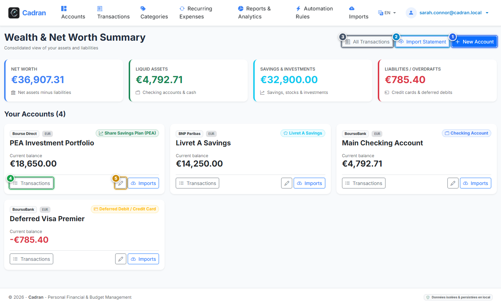

# Guía del Usuario: Panel Financiero y Patrimonio Neto

[← Volver al Índice General](../README.md) | [Siguiente: 07 - Crear Cuenta Bancaria →](07-create-account.md)

---

El **Panel Financiero** es el centro de control de Cadran. Muestra su patrimonio neto consolidado, la distribución de activos entre liquidez, ahorros y deudas, y ofrece acceso inmediato al libro de transacciones de cada cuenta.

---

## 1. Descripción Visual y Puntos de Acción

---

## 2. Tabla de Referencia de Acciones

| Marca | Elemento de Interfaz | Tipo de Acción | Qué hacer |
| :---: | :--- | :---: | :--- |
| <kbd>1</kbd> | **Botón "Nueva cuenta"** | **HACER CLIC AQUÍ** | Haga clic en este botón principal para añadir una cuenta bancaria (corriente, ahorro, inversión o tarjeta). |
| <kbd>2</kbd> | **Botón "Importar extracto"** | **HACER CLIC AQUÍ** | Haga clic para abrir el asistente de importación y cargar archivos CSV u OFX. |
| <kbd>3</kbd> | **Botón "Todas las transacciones"** | **HACER CLIC AQUÍ** | Haga clic para ver un libro unificado que agrupa los movimientos de todas sus cuentas. |
| <kbd>4</kbd> | **Botón "Transacciones"** | **HACER CLIC AQUÍ** | Haga clic en la tarjeta de una cuenta para consultar su registro detallado y saldo histórico. |
| <kbd>5</kbd> | **Botón "Editar"** | **HACER CLIC AQUÍ** | Haga clic para cambiar los ajustes de la cuenta (nombre descriptivo, entidad o saldo inicial). |

---

## 3. Indicadores Financieros Clave

Las cuatro tarjetas superiores calculan su posición en tiempo real:

- **Patrimonio Neto**: Saldo total consolidado (activos líquidos + inversiones - pasivos).
- **Activos Líquidos**: Fondos disponibles de inmediato en cuentas corrientes y efectivo.
- **Ahorro e Inversiones**: Valor total de libretas de ahorro, depósitos a plazo y carteras de valores.
- **Deudas y Compromisos**: Importe total adeudado en tarjetas de crédito de pago aplazado o préstamos.

---

## 4. Navegación Paso a Paso

1. **Revisar su situación patrimonial**: Consulte las cuatro tarjetas de KPIs para seguir la evolución del patrimonio.
2. **Acceder al registro de una cuenta**: Haga clic en el botón **Transacciones** (<kbd>4</kbd>) de la tarjeta elegida.
3. **Importar movimientos nuevos**: Haga clic en **Importar extracto** (<kbd>2</kbd>) para incorporar los ficheros de su banco.
4. **Vincular una nueva entidad**: Haga clic en **Nueva cuenta** (<kbd>1</kbd>) para dar de alta una nueva cuenta.
