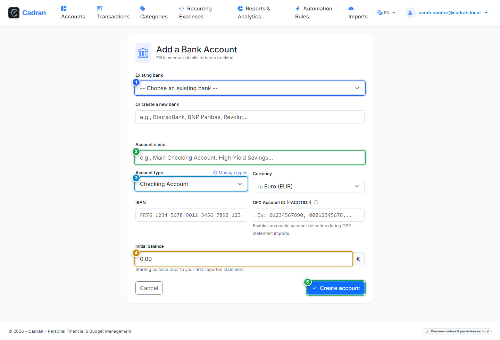

# Guía del Usuario: Crear Cuenta Bancaria

[← Volver al Panel](06-dashboard.md) | [Siguiente: 08 - Editar y Configurar Cuenta →](08-edit-account.md)

---

La pantalla **Crear Cuenta** le permite incorporar una cuenta bancaria a su espacio financiero. Puede elegir una entidad bancaria registrada o crear una nueva, seleccionar la categoría del producto y fijar el saldo de apertura.

---

## 1. Descripción Visual y Puntos de Acción

---

## 2. Tabla de Referencia de Acciones

| Marca | Elemento de Interfaz | Tipo de Acción | Qué hacer |
| :---: | :--- | :---: | :--- |
| <kbd>1</kbd> | **Entidad Bancaria** | **SELECCIONAR** | Elija un banco de su catálogo (ej. Santander, BBVA, CaixaBank) o seleccione **"Crear un nuevo banco..."** para añadir uno. |
| <kbd>2</kbd> | **Nombre de la Cuenta** | **RELLENAR** | Introduzca una etiqueta descriptiva (ej. `Cuenta Corriente Principal`, `Fondo de Emergencia`). |
| <kbd>3</kbd> | **Tipo de Cuenta** | **SELECCIONAR** | Elija la clasificación (Corriente, Ahorro, Inversión o Tarjeta). Determina cómo se totaliza en el panel. |
| <kbd>4</kbd> | **Saldo Inicial** | **RELLENAR** | Introduzca el saldo de apertura previo al primer extracto que vaya a importar (ej. `2845,50`). |
| <kbd>5</kbd> | **Botón "Crear cuenta"** | **HACER CLIC AQUÍ** | Haga clic para validar y crear la cuenta. Volverá al panel principal. |

---

## 3. Procedimiento Paso a Paso

1. **Seleccionar o registrar la entidad bancaria**:
   - Utilice el menú desplegable (<kbd>1</kbd>) para elegir su banco.
   - Si su banco no está en la lista, elija crear uno nuevo e indique su nombre y color.
2. **Nombrar la cuenta**:
   - En el campo **Nombre de la cuenta** (<kbd>2</kbd>), escriba un título reconocible.
3. **Elegir el tipo de producto**:
   - En el selector **Tipo de cuenta** (<kbd>3</kbd>), marque la opción idónea.
4. **Fijar el saldo de apertura**:
   - En el campo **Saldo inicial** (<kbd>4</kbd>), introduzca su saldo contable de referencia.
5. **Guardar la cuenta**:
   - Haga clic en el botón verde **Crear cuenta** (<kbd>5</kbd>) para finalizar.
