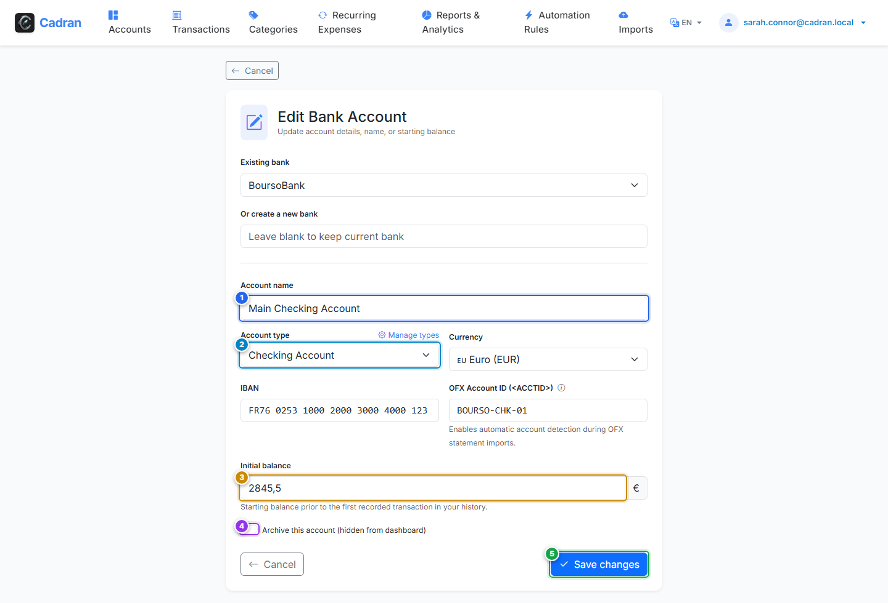

# Guía del Usuario: Editar y Configurar Cuenta

[← Volver a Crear Cuenta](07-create-account.md) | [Siguiente: 09 - Libro Mayor e Historial de Cuenta →](09-account-details.md)

---

La pantalla **Editar Cuenta** permite ajustar la configuración de una cuenta existente, corregir su saldo de apertura o archivarla cuando se haya cancelado.

---

## 1. Descripción Visual y Puntos de Acción

---

## 2. Tabla de Referencia de Acciones

| Marca | Elemento de Interfaz | Tipo de Acción | Qué hacer |
| :---: | :--- | :---: | :--- |
| <kbd>1</kbd> | **Nombre de la Cuenta** | **RELLENAR** | Modifique el nombre de la cuenta si desea renombrarla. |
| <kbd>2</kbd> | **Tipo de Cuenta** | **SELECCIONAR** | Modifique la categoría de activo (Corriente, Ahorro, Inversión o Tarjeta). |
| <kbd>3</kbd> | **Saldo Inicial** | **RELLENAR** | Ajuste el saldo de inicio si necesita rectificar desfases de conciliación pasados. |
| <kbd>4</kbd> | **Interruptor de Archivo** | **OPCIONAL** | Active esta opción si la cuenta está cerrada. Desaparecerá del panel pero conservará todo su historial. |
| <kbd>5</kbd> | **Botón "Guardar cambios"** | **HACER CLIC AQUÍ** | Haga clic para aplicar y almacenar las modificaciones. |

---

## 3. Procedimiento Paso a Paso

1. **Renombrar la cuenta (opcional)**:
   - Modifique el texto del campo **Nombre de la cuenta** (<kbd>1</kbd>).
2. **Reclasificar el tipo de cuenta (opcional)**:
   - En el menú **Tipo de cuenta** (<kbd>2</kbd>), cambie a otro grupo si es necesario.
3. **Corregir el saldo de partida (opcional)**:
   - En el campo **Saldo inicial** (<kbd>3</kbd>), introduzca el saldo corregido.
4. **Archivar una cuenta cerrada**:
   - Active el interruptor **Archivar esta cuenta** (<kbd>4</kbd>) para ocultarla de las vistas activas sin perder datos.
5. **Aplicar los cambios**:
   - Haga clic en el botón verde **Guardar cambios** (<kbd>5</kbd>).
