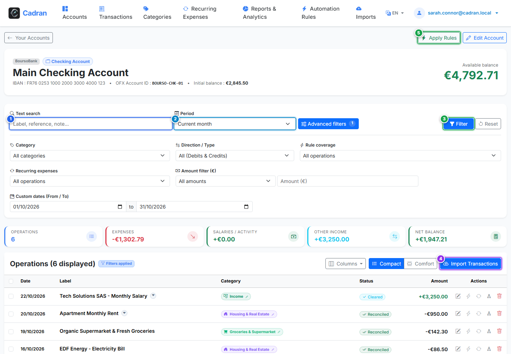

# Guía del Usuario: Libro Mayor e Historial de Cuenta

[← Volver a Editar Cuenta](08-edit-account.md) | [Siguiente: 10 - Tipos de Cuentas Personalizados →](10-account-types.md)

---

La pantalla **Libro Mayor de Cuenta** muestra el histórico íntegro de movimientos de una cuenta concreta. Desde este apartado puede buscar operaciones, filtrar por períodos, revisar categorías asignadas, importar extractos y ejecutar reglas automatizadas.

---

## 1. Descripción Visual y Puntos de Acción

---

## 2. Tabla de Referencia de Acciones

| Marca | Elemento de Interfaz | Tipo de Acción | Qué hacer |
| :---: | :--- | :---: | :--- |
| <kbd>1</kbd> | **Búsqueda de Texto** | **RELLENAR** | Introduzca una palabra clave (comercio, referencia o nota) para localizar transacciones. |
| <kbd>2</kbd> | **Selector de Período** | **SELECCIONAR** | Elija un intervalo (Mes actual, Mes anterior, Año actual o Todo el historial). |
| <kbd>3</kbd> | **Botón "Filtrar"** | **HACER CLIC AQUÍ** | Haga clic para refrescar el listado con los filtros indicados. |
| <kbd>4</kbd> | **Botón "Importar transacciones"** | **HACER CLIC AQUÍ** | Haga clic para abrir el asistente de importación preconfigurado para esta cuenta. |
| <kbd>5</kbd> | **Botón "Aplicar reglas"** | **HACER CLIC AQUÍ** | Haga clic para ejecutar las reglas de categorización sobre los movimientos pendientes de esta cuenta. |

---

## 3. Información de la Cuenta y Controles del Registro

- **Tarjeta de Saldo**: Muestra el saldo actual, IBAN e identificador bancario OFX en la cabecera superior.
- **Gráfico de Reparto por Categorías**: Visualiza los gastos e ingresos del intervalo elegido justo encima de la tabla.
- **Tabla de Transacciones**: Refleja la fecha contable, comercio o concepto, distintivo de categoría, etiqueta de estado e importes en débito/crédito.

---

## 4. Procedimiento Paso a Paso

1. **Buscar transacciones pasadas**:
   - Escriba el término deseado en el recuadro **Buscar** (<kbd>1</kbd>).
   - Elija el intervalo temporal en el menú **Período** (<kbd>2</kbd>).
   - Haga clic en **Filtrar** (<kbd>3</kbd>) para actualizar la cuadrícula.
2. **Importar extractos**:
   - Haga clic en **Importar transacciones** (<kbd>4</kbd>) para subir un fichero CSV u OFX.
3. **Automatizar la clasificación**:
   - Haga clic en **Aplicar reglas** (<kbd>5</kbd>) para vincular conceptos con categorías y beneficiarios.
