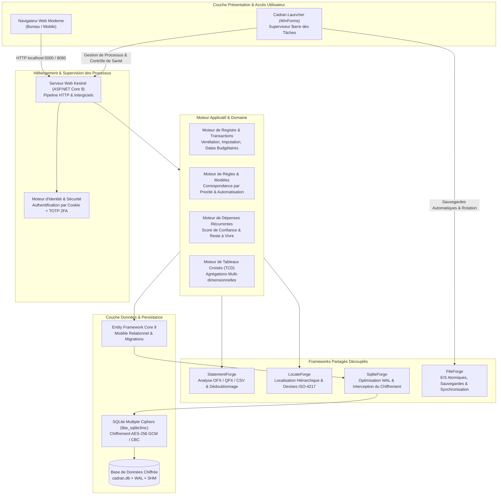
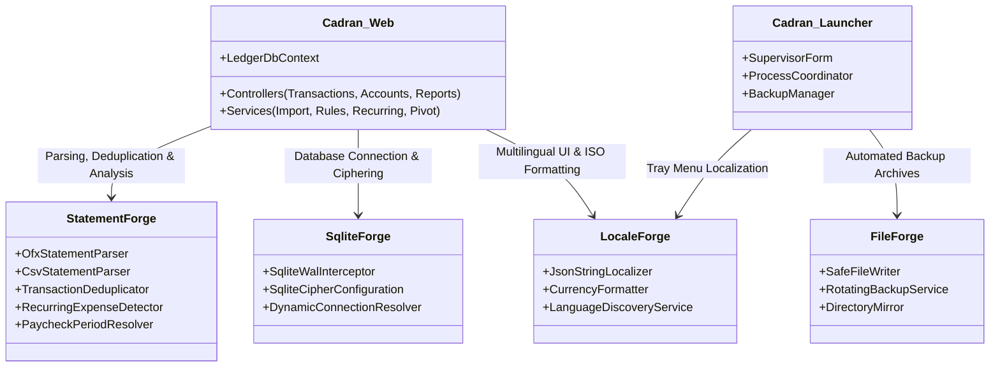
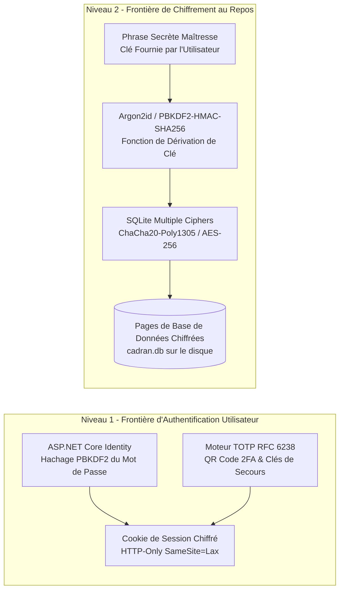

# Cadran - Spécification d'Architecture & d'Ingénierie

  <strong>Langues :</strong>
  <a href="../architecture.md">English</a> |
  <strong>Français</strong> |
  <a href="../es/architecture.md">Español</a> |
  <a href="../de/architecture.md">Deutsch</a>

## 1. Résumé Exécutif de l'Architecture

**Cadran** est une plateforme haute performance de gestion de finances personnelles et de patrimoine, locale et souveraine, développée sur ASP.NET Core 9 et C# 12. Conçue rigoureusement selon les paradigmes **Local-First** et **Privacy-First**, Cadran fonctionne de manière 100 % autonome, sans services d'agrégation cloud, télémétrie distante ni analyse tierce.

La plateforme est articulée autour de deux exécutables principaux :
1. **Cadran (Moteur Serveur Web)** : Une application ASP.NET Core 9 hébergeant une interface utilisateur réactive, le moteur de domaine métier, le livre de comptes transactionnel et une couche de stockage SQLite chiffrée.
2. **Cadran.Launcher (Superviseur Windows)** : Un utilitaire Windows léger résidant dans la barre d'état système qui supervise le cycle de vie du moteur web, orchestre les sauvegardes automatiques de la base de données au démarrage et à l'arrêt, et ouvre le navigateur système par défaut.

---

## 2. Architecture des Frameworks Partagés Découplés

Cadran respecte les principes de la Clean Architecture et de l'inversion de dépendances. Les opérations de domaine, d'analyse syntaxique, de persistance et de localisation reposent sur des bibliothèques modulaires réutilisables publiées sous l'écosystème `curvecoder` :

### 2.1. Responsabilités des Frameworks
- **StatementForge** : Fournit des parseurs en flux continu pour les formats Open Financial Exchange (OFX 1.x et 2.x), Quicken Financial Exchange (QFX) et les fichiers délimités personnalisables CSV/TSV. Implémente des algorithmes de correspondance floue pour éliminer les doublons et calcule la signature fréquentielle des dépenses récurrentes.
- **SqliteForge** : Configure les paramètres SQLite natifs, active le Write-Ahead Logging (`PRAGMA journal_mode=WAL`), applique l'intégrité relationnelle (`PRAGMA foreign_keys=ON`) et fait le pont entre ASP.NET Core et `libe_sqlite3mc` pour le chiffrement par phrase secrète maîtresse.
- **LocaleForge** : Fournit un système de localisation JSON hiérarchique sans réflexion pour un bilinguisme complet (`en-US` et `fr-FR`), associé au formatage monétaire normalisé ISO-4217 sur l'ensemble des comptes.
- **FileForge** : Prend en charge les opérations atomiques sur le système de fichiers, la rotation des sauvegardes compressées horodatées et l'écriture sécurisée résiliente aux plantages.

---

## 3. Architecture de Stockage, Chiffrement & Sécurité

### 3.1. Modèle de Sécurité à Deux Niveaux
Cadran isole les données et l'authentification à travers deux barrières défensives indépendantes :

1. **Authentification Utilisateur (Niveau 1)** :
   - Chaque utilisateur enregistré dispose d'un espace cloisonné (`UserId`).
   - Les mots de passe sont protégés via PBKDF2 sous ASP.NET Core Identity avec des sels cryptographiques uniques.
   - **Authentification à Deux Facteurs TOTP (Non testée / Prévue pour suppression)** : L'authentification à deux facteurs TOTP par mot de passe à usage unique a été initialement implémentée avec des clés de récupération hors-ligne. Toutefois, l'exposition publique directe de Cadran sur Internet n'est pas recommandée. Cadran étant conçu pour fonctionner localement ou au sein d'un réseau privé de confiance, la 2FA TOTP est **non testée et sera retirée dans une version ultérieure**. Les utilisateurs nécessitant un accès distant doivent passer par un VPN privé (tel que WireGuard) plutôt que d'ouvrir des ports vers Internet.
2. **Chiffrement de la Base au Repos (Niveau 2)** :
   - Chiffrement complet optionnel au niveau bloc opéré par **SQLite Multiple Ciphers (SQLCipher / AES-256)**.
   - Une fois activé, les pages brutes sur le disque sont totalement illisibles sans la clé de déchiffrement maîtresse.
   - Le déchiffrement transparent en mémoire est pris en charge par `libe_sqlite3mc` au niveau du runtime C, sans jamais écrire de fichier temporaire déchiffré sur le disque.

### 3.2. Concurrence SQLite & Mode WAL
- Le pool de connexions utilise `journal_mode=WAL` (Write-Ahead Logging) et `synchronous=NORMAL`.
- Les lecteurs ne bloquent jamais les rédacteurs, et les rédacteurs ne bloquent jamais les lecteurs.
- Des points de contrôle (checkpoints) d'arrière-plan réintègrent périodiquement les enregistrements `-wal` et `-shm` dans `cadran.db` pour éviter l'accroissement démesuré des fichiers journaux.

---

## 4. Modèle de Threads & Gestion de la Mémoire

### 4.1. Pipeline d'E/S Asynchrone
- Chaque action de contrôleur et requête EF Core s'appuie sur le pattern `async/await` avec propagation systématique du jeton `CancellationToken`.
- Les requêtes HTTP sont traitées par le pool de threads .NET sans aucun appel synchrone bloquant (l'utilisation de `.Result` ou `.Wait()` est formellement proscrite).

### 4.2. Allocation Mémoire & Garbage Collection
- L'analyse des relevés bancaires (OFX/CSV) exploite des flux mappés en mémoire et les types `Span<T>` / `ReadOnlySpan<char>` pour limiter la fragmentation du Large Object Heap (LOH).
- Les calculs d'agrégation des Tableaux Croisés Dynamiques (TCD) exécutent des projections streaming côté base de données (`Select`) afin d'éviter la matérialisation superflue d'entités volumineuses en mémoire.
- Le serveur fonctionne avec une empreinte mémoire particulièrement sobre (généralement inférieure à **90 Mo** de working set privé en régime stabilisé).

---

## 5. Performances & Métriques

| Métrique | Objectif | Valeur Observée |
|---|---|---|
| **Démarrage à Froid du Serveur** | < 1,5 seconde | ~ 850 ms (Release x64) |
| **Import de Relevé OFX (10 000 écritures)** | < 1,0 seconde | ~ 320 ms |
| **Moteur d'Exécution de Règles (5 000 règles)** | < 100 ms | ~ 35 ms |
| **Agrégation Tableau Croisé Dynamique (50 000 écritures)** | < 250 ms | ~ 95 ms |
| **Empreinte du Binaire Autonome** | < 150 Mo | ~ 100 Mo (Self-contained x64) |
