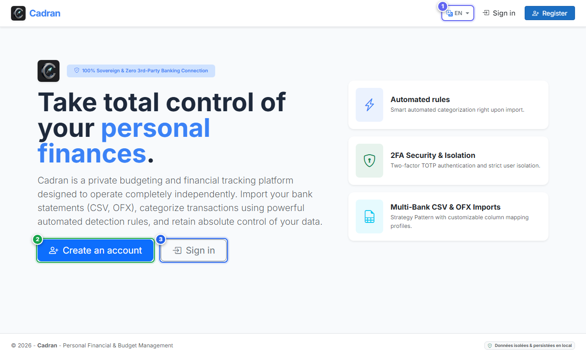

# Guide Utilisateur : Bienvenue & Premier Lancement

[← Retour à l'Index Général](../README.md) | [Suivant : 02 - Inscription →](02-register.md)

---

L'**Écran de Bienvenue** est la première page affichée lorsque vous lancez Cadran pour la toute première fois. Il donne un accès direct au choix de la langue, à la création de votre compte ou à la connexion si vous disposez déjà d'un profil.

---

## 1. Vue d'Ensemble & Repères Visuels

---

## 2. Tableau de Référence des Actions

| Repère | Élément d'Interface | Type d'Action | Consigne |
| :---: | :--- | :---: | :--- |
| <kbd>1</kbd> | **Sélecteur de Langue** | **SÉLECTIONNER** | Cliquez sur la liste déroulante en haut à droite pour basculer entre l'anglais (`EN`) et le français (`FR`). |
| <kbd>2</kbd> | **Bouton "Créer un compte"** | **CLIQUER ICI** | Cliquez sur ce bouton principal pour ouvrir le formulaire d'inscription et créer votre profil administrateur. |
| <kbd>3</kbd> | **Bouton "Se connecter"** | **CLIQUER ICI** | Cliquez sur ce bouton si votre compte est déjà créé afin d'accéder directement à l'écran de connexion. |

---

## 3. Procédure Étape par Étape

1. **Choisir votre langue** :
   - Dans la barre de navigation supérieure droite (repère **[1]**), sélectionnez **EN** pour l'anglais ou **FR** pour le français.
2. **Démarrer votre inscription initiale** :
   - Cliquez sur le bouton bleu **Créer un compte** (repère **[2]**).
   - Vous pouvez également cliquer sur **S'inscrire** dans la barre de navigation.
3. **Si vous possédez déjà un compte** :
   - Cliquez sur le bouton **Se connecter** (repère **[3]**) pour accéder au formulaire de connexion.
