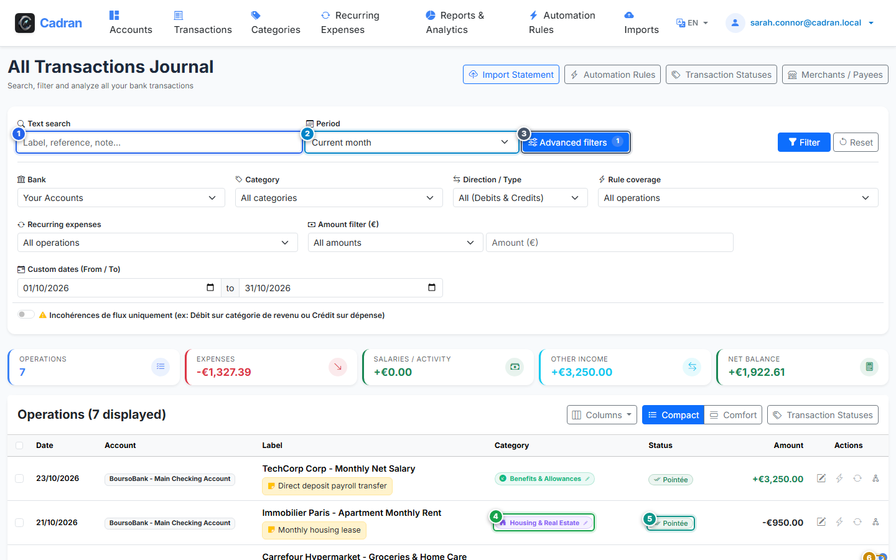

# Guide Utilisateur : Livre de Comptes & Journal Unifié des Opérations

[← Retour à l'Index Général](../README.md) | [Suivant : 13 - Modifier une Transaction & Détails de Catégorie →](13-edit-transaction.md)

---

Le **Livre de Comptes Unifié** regroupe dans une vue consolidée l'ensemble des débits, crédits et virements de tous vos comptes bancaires. Depuis cet écran, vous pouvez rechercher, filtrer, pointer et catégoriser vos opérations.

---

## 1. Vue d'Ensemble & Repères Visuels

---

## 2. Tableau de Référence des Actions

| Repère | Élément d'Interface | Type d'Action | Consigne |
| :---: | :--- | :---: | :--- |
| <kbd>1</kbd> | **Champ de recherche** | **SAISIR DU TEXTE** | Saisissez des mots-clés pour filtrer instantanément par libellé bancaire, tiers ou note personnelle. |
| <kbd>2</kbd> | **Sélecteur de période** | **CHOISIR L'OPTION** | Sélectionnez la plage temporelle souhaitée (Mois en cours, Mois précédent, Année en cours, Tout l'historique). |
| <kbd>3</kbd> | **Filtres avancés** | **CLIQUER ICI** | Dépliez le panneau multi-critères pour isoler des comptes précis, des fourchettes de montants ou des catégories. |
| <kbd>4</kbd> | **Badge de catégorie** | **CLIQUER ICI** | Cliquez sur la cellule de catégorie d'une ligne pour ouvrir la fenêtre de modification et d'affectation. |
| <kbd>5</kbd> | **Bouton de pointage de statut** | **CLIQUER ICI** | Cliquez sur le badge de statut pour faire basculer l'opération (*En attente*, *Pointée*, *Rapprochée*). |
| <kbd>6</kbd> | **Badge de ventilation de dépense** | **CLIQUER ICI** | Cliquez sur l'icône de ventilation des opérations multi-catégories pour ouvrir le détail du ticket de caisse. |

---

## 3. États de Rapprochement Bancaire

Une opération bancaire suit un cycle de vie en trois étapes claires :

- **En attente (Pending)** : L'opération est initiée ou autorisée par carte mais n'apparaît pas encore sur votre relevé officiel.
- **Pointée (Cleared)** : L'opération apparaît sur votre relevé bancaire intermédiaire et les montants concordent.
- **Rapprochée (Reconciled)** : L'écriture a été formellement vérifiée lors du contrôle de fin de mois ou de l'arrêté de compte.

---

## 4. Navigation Étape par Étape

1. **Localiser une opération** : Saisissez un mot-clé (<kbd>1</kbd>) ou sélectionnez un mois précis (<kbd>2</kbd>).
2. **Assigner ou modifier la catégorie** : Cliquez sur le badge (<kbd>4</kbd>) pour changer la classification.
3. **Pointer l'écriture** : Cliquez sur l'indicateur (<kbd>5</kbd>) pour rapprocher l'opération avec votre relevé bancaire.
4. **Consulter la ventilation** : Si un achat regroupe plusieurs postes (ex. courses et bricolage), cliquez sur le badge (<kbd>6</kbd>).
