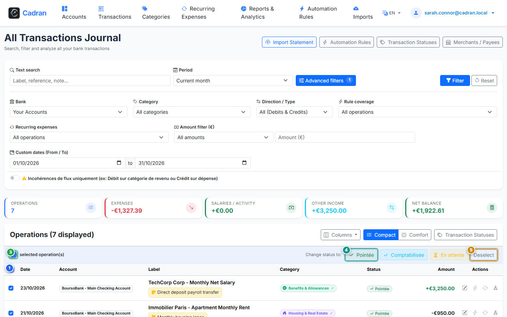

# Guide Utilisateur : Rapprochements Groupés & Actions en Masse

[← Précédent : 14 - Ventiler une Transaction](14-split-transaction.md) | [← Retour à l'Index Général](../README.md) | [Suivant : 16 - Arborescence des Catégories →](16-categories.md)

---

La **Barre d'Actions Groupées** apparaît automatiquement dès que plusieurs opérations sont cochées dans le livre de comptes, vous permettant de pointer, rapprocher ou reclasser plusieurs dizaines d'écritures en un seul clic.

---

## 1. Vue d'Ensemble & Repères Visuels

---

## 2. Tableau de Référence des Actions

| Repère | Élément d'Interface | Type d'Action | Consigne |
| :---: | :--- | :---: | :--- |
| <kbd>1</kbd> | **Case principale "Tout sélectionner"** | **CLIQUER / COCHER** | Cochez ou décochez instantanément toutes les opérations visibles sur la page en cours. |
| <kbd>2</kbd> | **Case de sélection de ligne** | **CLIQUER / COCHER** | Cochez individuellement chaque écriture que vous souhaitez intégrer au traitement par lot. |
| <kbd>3</kbd> | **Compteur d'éléments sélectionnés** | **BADGE D'ÉTAT** | Affiche en direct le nombre exact d'opérations actuellement cochées. |
| <kbd>4</kbd> | **Action de rapprochement groupé** | **CLIQUER ICI** | Appliquez en bloc le statut choisi (*Rapproché*, *Pointé*) à l'intégralité des écritures cochées. |
| <kbd>5</kbd> | **Bouton d'annulation de sélection** | **CLIQUER ICI** | Décochez toutes les lignes sélectionnées et masquez la barre flottante d'actions. |

---

## 3. Méthodologie Recommandée pour le Pointage Mensuel

1. **Filtrer par relevé** : Utilisez le sélecteur de période pour afficher le mois écoulé.
2. **Pointer les écritures vérifiées** : Cochez les cases (<kbd>2</kbd>) au fur et à mesure de votre lecture du relevé papier ou PDF de votre banque.
3. **Valider en bloc** : Cliquez sur le bouton de rapprochement (<kbd>4</kbd>) pour verrouiller toutes les opérations vérifiées.
4. **Fermer la sélection** : Cliquez sur le bouton (<kbd>5</kbd>) pour réinitialiser la vue.
