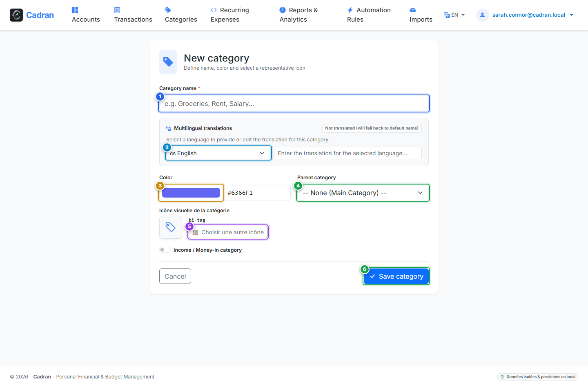

# Guide Utilisateur : Créer & Modifier une Catégorie

[← Précédent : 16 - Arborescence des Catégories](16-categories.md) | [← Retour à l'Index Général](../README.md) | [Suivant : 18 - Moteur de Règles Automatiques →](18-rules-engine.md)

---

Le **Formulaire de Catégorie** permet de créer de nouvelles rubriques comptables ou d'ajuster des rubriques existantes, d'associer des codes couleurs et des icônes distinctives, de configurer des traductions multilingues et d'identifier les catégories de salaires.

---

## 1. Vue d'Ensemble & Repères Visuels

---

## 2. Tableau de Référence des Actions

| Repère | Élément d'Interface | Type d'Action | Consigne |
| :---: | :--- | :---: | :--- |
| <kbd>1</kbd> | **Nom de la catégorie** | **SAISIR LE NOM** | Renseignez le libellé principal de la catégorie (ex. *Courses*, *Entretien du Véhicule*). |
| <kbd>2</kbd> | **Traductions multilingues** | **CHOISIR / SAISIR** | Renseignez les intitulés traduits dans d'autres langues (Anglais, Espagnol, Allemand). |
| <kbd>3</kbd> | **Sélecteur de couleur** | **CHOISIR LA TEINTE** | Définissez une couleur représentative pour vos graphiques et vos badges d'opérations. |
| <kbd>4</kbd> | **Groupe parent de rattachement** | **CHOISIR L'OPTION** | Choisissez un groupe parent pour en faire une sous-catégorie, ou laissez vide pour créer un grand groupe racine. |
| <kbd>5</kbd> | **Sélecteur visuel d'icône** | **CLIQUER ICI** | Ouvrez la grille d'icônes pour choisir un symbole visuel parlant parmi la bibliothèque intégrée. |
| <kbd>6</kbd> | **Bouton "Enregistrer"** | **CLIQUER ICI** | Validez la création ou modification de la catégorie pour revenir à l'arborescence. |

---

## 3. Grand Groupe Parent vs Sous-Catégorie

- Pour créer un **Grand Groupe Parent** : Laissez le champ **Groupe parent** (<kbd>4</kbd>) vide.
- Pour créer une **Sous-catégorie** : Choisissez le parent approprié dans la liste déroulante (<kbd>4</kbd>). La sous-catégorie héritera automatiquement de la qualification (revenu ou dépense) de son parent.

---

## 4. Instructions Pas à Pas

1. **Renseigner l'intitulé** : Saisissez le libellé dans le champ principal (<kbd>1</kbd>).
2. **Définir la position hiérarchique** : Sélectionnez un groupe parent (<kbd>4</kbd>) ou laissez vide.
3. **Personnaliser l'apparence** : Sélectionnez une couleur (<kbd>3</kbd>) et cliquez sur **Choisir une icône** (<kbd>5</kbd>).
4. **Ajouter des traductions** : Si vous utilisez plusieurs langues, complétez les traductions (<kbd>2</kbd>).
5. **Enregistrer** : Cliquez sur le bouton principal **Enregistrer** (<kbd>6</kbd>).
