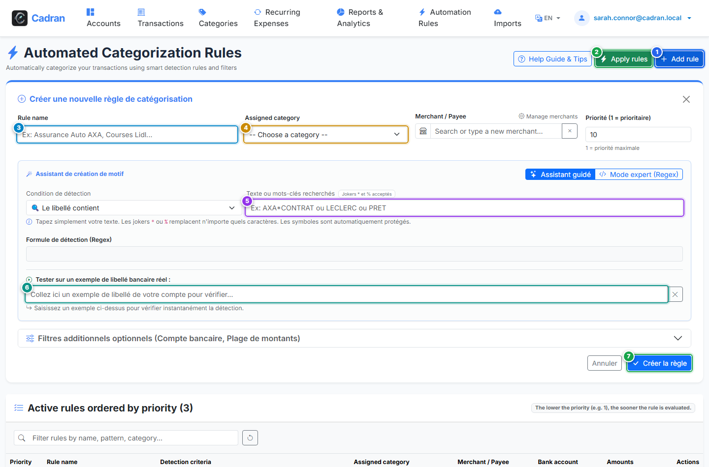

# Guide Utilisateur : Moteur de Règles d'Auto-Catégorisation

[← Précédent : 17 - Créer & Modifier une Catégorie](17-create-category.md) | [← Retour à l'Index Général](../README.md) | [Suivant : 19 - Échéancier des Charges Récurrentes →](19-recurring-transactions.md)

---

Le **Moteur de Règles Automatiques** classe automatiquement vos opérations bancaires et leur associe un commerçant. Lors de l'import d'un relevé ou de la saisie d'écritures, Cadran évalue vos règles actives par ordre de priorité et applique immédiatement les affectations définies.

---

## 1. Vue d'Ensemble & Repères Visuels

---

## 2. Tableau de Référence des Actions

| Repère | Élément d'Interface | Type d'Action | Consigne |
| :---: | :--- | :---: | :--- |
| <kbd>1</kbd> | **Bouton "Ajouter une règle"** | **CLIQUER ICI** | Dépliez le formulaire de configuration pour définir une nouvelle règle de détection. |
| <kbd>2</kbd> | **Bouton "Appliquer aux existantes"** | **CLIQUER ICI** | Exécutez l'ensemble de vos règles de manière rétroactive sur toutes vos écritures passées non classées. |
| <kbd>3</kbd> | **Nom de la règle** | **SAISIR LE NOM** | Donnez un titre explicite (ex. *Courses Supermarché*, *Factures d'Énergie*). |
| <kbd>4</kbd> | **Catégorie cible assignée** | **CHOISIR L'OPTION** | Sélectionnez la catégorie qui sera automatiquement affectée lors de la correspondance. |
| <kbd>5</kbd> | **Mots-clés & Jokers de recherche** | **SAISIR DU TEXTE** | Saisissez les termes à détecter (ex. `CARREFOUR*` ou `EDF`). Les jokers `*` et `%` sont supportés. |
| <kbd>6</kbd> | **Testeur sur libellé bancaire réel** | **TESTER EN DIRECT** | Collez un exemple réel extrait de votre relevé bancaire pour vérifier instantanément la détection. |
| <kbd>7</kbd> | **Bouton "Créer la règle"** | **CLIQUER ICI** | Enregistrez la règle pour l'activer immédiatement dans le catalogue des règles actives. |

---

## 3. Conditions de Correspondance & Priorité

- **Contient** : S'active si les mots-clés apparaissent n'importe où dans le texte brut de votre banque.
- **Commence par / Se termine par** : S'active si le terme apparaît au tout début ou à la fin du libellé.
- **Jokers autorisés** : Le caractère `*` ou `%` remplace n'importe quelle séquence de lettres ou chiffres (ex. `AMAZON*PRIME`).
- **Ordre d'évaluation** : Les règles s'exécutent de la plus prioritaire (priorité 1) à la moins prioritaire. Dès qu'une règle correspond, l'évaluation s'arrête pour cette opération.

---

## 4. Instructions Pas à Pas

1. **Ouvrir le formulaire** : Cliquez sur **Ajouter une règle** (<kbd>1</kbd>).
2. **Nommer et cibler** : Saisissez un libellé (<kbd>3</kbd>) et choisissez la catégorie cible (<kbd>4</kbd>).
3. **Définir les critères** : Tapez vos mots-clés ou l'expression souhaitée (<kbd>5</kbd>).
4. **Vérifier avec un exemple** : Collez un libellé bancaire réel dans la zone de test (<kbd>6</kbd>) pour confirmer la détection.
5. **Sauvegarder** : Cliquez sur **Créer la règle** (<kbd>7</kbd>).
6. **Classer l'historique** : Cliquez sur **Appliquer aux existantes** (<kbd>2</kbd>) pour catégoriser vos anciennes opérations d'un seul coup.
