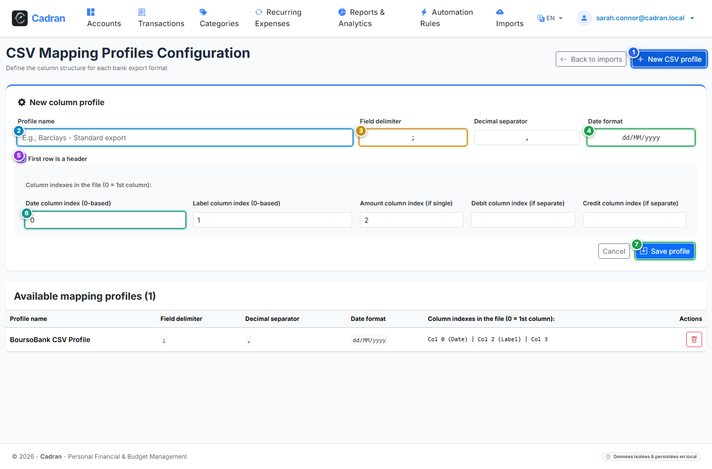

# Guide Utilisateur : Créateur de Profil d'Import CSV

[← Précédent : 20 - Import de Relevés (OFX / CSV)](20-statement-imports.md) | [← Retour à l'Index Général](../README.md) | [Suivant : 22 - Rapports Financiers & Graphiques →](22-financial-reports.md)

---

Le **Créateur de Profil CSV** vous permet de faire correspondre les colonnes de n'importe quel export bancaire (Boursorama, BNP Paribas, Crédit Agricole, La Banque Postale, Revolut, etc.) avec les champs comptables fondamentaux de Cadran.

---

## 1. Vue d'Ensemble & Repères Visuels

---

## 2. Tableau de Référence des Actions

| Repère | Élément d'Interface | Type d'Action | Consigne |
| :---: | :--- | :---: | :--- |
| <kbd>1</kbd> | **Bouton "Nouveau profil"** | **CLIQUER ICI** | Dépliez le formulaire de configuration pour paramétrer un nouveau format bancaire CSV. |
| <kbd>2</kbd> | **Nom du profil** | **SAISIR LE NOM** | Donnez un intitulé reconnaissable (ex. *Export Standard BoursoBank*, *Relevé Mensuel N26*). |
| <kbd>3</kbd> | **Séparateur de colonnes & Décimale** | **SAISIR LE CARACTÈRE** | Spécifiez le délimiteur de champs (couramment `;`, `,` ou `\t`) et le séparateur décimal (`,` ou `.`). |
| <kbd>4</kbd> | **Format de date** | **SAISIR LE MOTIF** | Précisez la structure des dates dans le fichier (ex. `dd/MM/yyyy`, `yyyy-MM-dd` ou `MM/dd/yyyy`). |
| <kbd>5</kbd> | **Case "Ligne d'en-tête présente"** | **COCHER LA CASE** | Cochez si la première ligne du fichier contient les noms de colonnes afin que Cadran l'ignore. |
| <kbd>6</kbd> | **Index des colonnes** | **SAISIR LES NUMÉROS** | Renseignez les numéros de colonnes (base 0) pour la Date (0), le Libellé (1) et le Montant (2). |
| <kbd>7</kbd> | **Bouton "Enregistrer le profil"** | **CLIQUER ICI** | Sauvegardez le profil pour le rendre immédiatement disponible dans la page d'import. |

---

## 3. Comprendre les Index de Colonnes en Base 0

Dans un tableur Excel ou un fichier texte CSV :
- Colonne A = Index **0**
- Colonne B = Index **1**
- Colonne C = Index **2**
- Colonne D = Index **3**

Si votre banque sépare les débits et les crédits en deux colonnes distinctes plutôt qu'une colonne de montant signé unique, vous pouvez laisser le champ Montant vide et renseigner les index respectifs des colonnes Débit et Crédit.

---

## 4. Instructions Pas à Pas

1. **Ouvrir le formulaire** : Cliquez sur **Nouveau profil** (<kbd>1</kbd>).
2. **Identifier la banque** : Saisissez le nom de votre établissement (<kbd>2</kbd>).
3. **Paramétrer la ponctuation** : Indiquez le séparateur (<kbd>3</kbd>) et la syntaxe de date (<kbd>4</kbd>).
4. **Faire correspondre les colonnes** : Ouvrez votre fichier CSV dans un éditeur et reportez les numéros de colonnes (<kbd>6</kbd>).
5. **Enregistrer** : Cliquez sur **Enregistrer le profil** (<kbd>7</kbd>).
