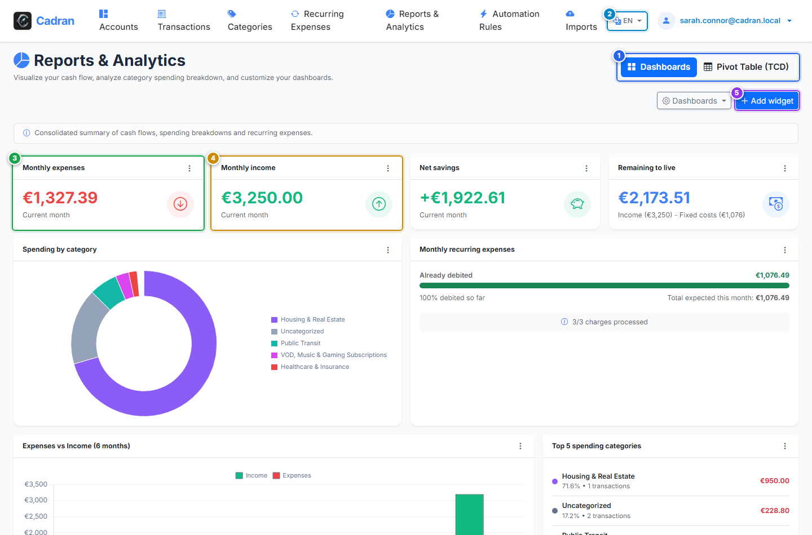

# Guide Utilisateur : Rapports Financiers & Analyses Graphiques

[← Précédent : 21 - Créateur de Profil d'Import CSV](21-import-mapping.md) | [← Retour à l'Index Général](../README.md) | [Suivant : 23 - Paramètres d'Apparence & Thèmes →](23-appearance-settings.md)

---

Le module de **Rapports Financiers & Analyses** vous procure une vision synthétique de vos flux financiers, de la ventilation de vos dépenses par catégorie, de vos tendances temporelles et met à votre disposition un Tableau Croisé Dynamique (TCD) pour une exploration multi-dimensionnelle.

---

## 1. Vue d'Ensemble & Repères Visuels

---

## 2. Tableau de Référence des Actions

| Repère | Élément d'Interface | Type d'Action | Consigne |
| :---: | :--- | :---: | :--- |
| <kbd>1</kbd> | **Sélecteur de mode de vue** | **CLIQUER SUR L'ONGLET** | Basculez entre les Tableaux de Bord visuels (graphiques & widgets) et le Tableau Croisé Dynamique (TCD). |
| <kbd>2</kbd> | **Menu "Gérer les tableaux de bord"** | **CLIQUER ICI** | Ouvrez le menu pour créer un tableau de bord sur mesure ou réinitialiser les réglages par défaut. |
| <kbd>3</kbd> | **Graphique de répartition par catégorie** | **SURVOLER / EXPLORER** | Diagramme en anneau représentant la part relative de chaque catégorie de dépense. |
| <kbd>4</kbd> | **Widget des postes majeurs** | **CONSULTER LA LISTE** | Classement des catégories les plus dépensières du mois avec leurs pourcentages respectifs. |
| <kbd>5</kbd> | **Bouton "Ajouter un widget"** | **CLIQUER ICI** | Insérez de nouvelles cartes visuelles (jauges, indicateurs chiffrés, barres, listes personnalisées). |

---

## 3. Exploration Multi-Dimensionnelle avec le TCD

En basculant sur l'onglet **Tableau Croisé Dynamique** (<kbd>1</kbd>) :
- Croisez vos données comptables selon plusieurs axes : comptes, catégories, années et mois.
- Cliquez sur n'importe quelle cellule chiffrée pour afficher la liste exhaustive des transactions correspondantes.
- Enregistrez vos configurations de filtres personnalisées pour les retrouver instantanément lors de vos bilans réguliers.

---

## 4. Instructions Pas à Pas

1. **Analyser vos dépenses** : Observez le diagramme circulaire (<kbd>3</kbd>) et la liste des principaux postes (<kbd>4</kbd>).
2. **Ajouter un indicateur** : Cliquez sur **Ajouter un widget** (<kbd>5</kbd>) et sélectionnez le format de votre choix.
3. **Approfondir avec le TCD** : Cliquez sur l'onglet **Tableau croisé dynamique** (<kbd>1</kbd>) pour explorer vos écritures en profondeur.
4. **Créer un tableau de bord dédié** : Utilisez le menu (<kbd>2</kbd>) pour créer une vue distincte (ex. pour vos projets immobiliers ou activités professionnelles).
