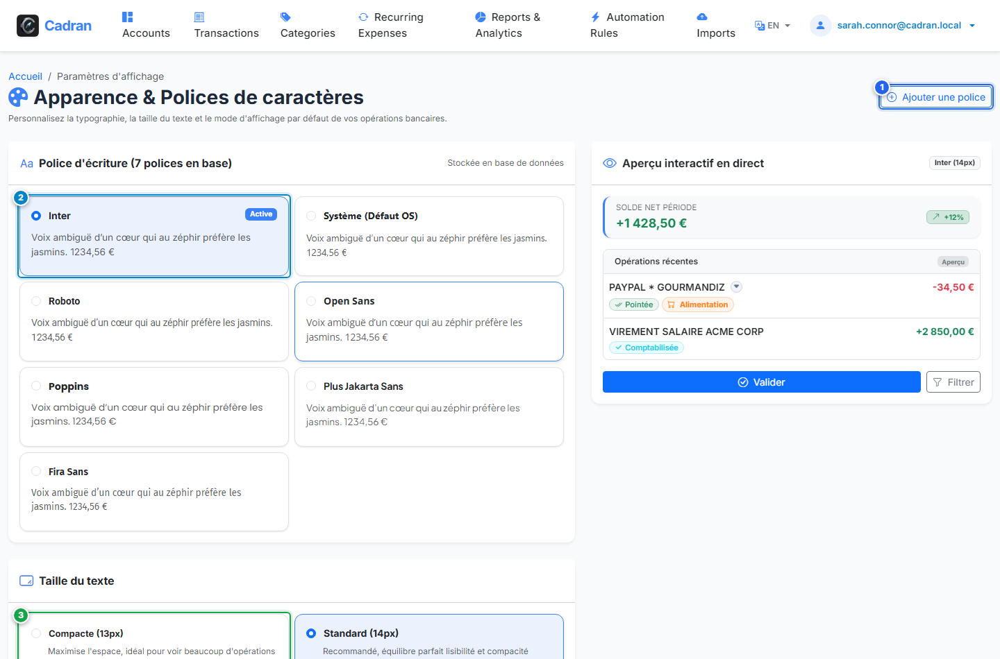

# Guide Utilisateur : Paramètres d'Apparence & Typographie

[← Précédent : 22 - Rapports Financiers & Graphiques](22-financial-reports.md) | [← Retour à l'Index Général](../README.md) | [Suivant : 24 - Lanceur Windows Tray & Sauvegardes →](24-backups-supervision.md)

---

L'écran **Apparence & Typographie** vous permet d'adapter le rendu visuel de Cadran à votre écran, à votre résolution et à vos préférences ergonomiques (choix de la police d'écriture, échelle du texte, densité des tableaux et modes d'affichage du journal).

---

## 1. Vue d'Ensemble & Repères Visuels

---

## 2. Tableau de Référence des Actions

| Repère | Élément d'Interface | Type d'Action | Consigne |
| :---: | :--- | :---: | :--- |
| <kbd>1</kbd> | **Bouton "Ajouter une police"** | **CLIQUER ICI** | Ouvrez la fenêtre pour importer une police Google Fonts ou système dans votre catalogue. |
| <kbd>2</kbd> | **Choix de la police d'écriture** | **SÉLECTIONNER LA CARTE** | Sélectionnez votre police préférée (Inter, Roboto, Segoe UI, Fira Code, Outfit...). |
| <kbd>3</kbd> | **Échelle de taille du texte** | **CHOISIR LA TAILLE** | Ajustez la taille de police globale de Compacte (13px) à Grande (16px) selon votre écran. |
| <kbd>4</kbd> | **Mode d'affichage des écritures** | **BASCULER LE MODE** | Choisissez entre le mode *Compact* (libellé épuré) et le mode *Confort* (toutes les lignes déployées). |
| <kbd>5</kbd> | **Bouton "Enregistrer les préférences"** | **CLIQUER ICI** | Appliquez immédiatement vos choix visuels à l'ensemble des pages de l'application. |

---

## 3. Mode Compact vs Mode Confort

- **Mode Compact** : Conçu pour les utilisateurs manipulant des historiques denses. Les lignes sont resserrées et les références techniques masquées. Un clic sur *Détails* déplie les mémos bruts.
- **Mode Confort** : Affiche directement sur chaque écriture l'intégralité des informations (libellé propre, descriptif bancaire brut et numéro de chèque ou virement).

---

## 4. Instructions Pas à Pas

1. **Sélectionner votre typographie** : Parcourez les cartes (<kbd>2</kbd>) et cliquez sur la police de votre choix.
2. **Régler la taille des caractères** : Choisissez une échelle (<kbd>3</kbd>) assurant un confort de lecture optimal.
3. **Définir la densité du journal** : Sélectionnez le mode Compact ou Confort (<kbd>4</kbd>).
4. **Appliquer les réglages** : Cliquez sur le bouton vert **Enregistrer les préférences** (<kbd>5</kbd>).
