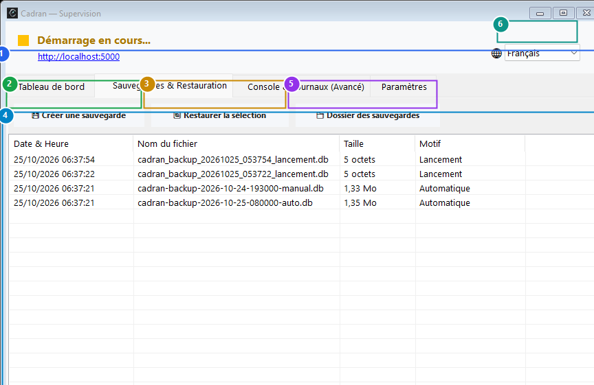

# Guide Utilisateur : Lanceur Windows Tray & Sauvegardes Automatiques

[← Précédent : 23 - Paramètres d'Apparence & Thèmes](23-appearance-settings.md) | [← Retour à l'Index Général](../README.md)

---

Le **Lanceur de Supervision Cadran** pilote le serveur web d'arrière-plan, surveille la santé du processus applicatif et orchestre les sauvegardes automatiques de la base de données avec rétention maîtrisée. Il réside discrètement dans votre zone de notification Windows (près de l'horloge).

---

## 1. Vue d'Ensemble & Repères Visuels

---

## 2. Tableau de Référence des Actions

| Repère | Élément d'Interface | Type d'Action | Consigne |
| :---: | :--- | :---: | :--- |
| <kbd>1</kbd> | **Onglets de supervision** | **CLIQUER SUR L'ONGLET** | Basculez entre le Tableau de bord serveur, les Sauvegardes, les Journaux d'activité et les Paramètres. |
| <kbd>2</kbd> | **Bouton "Créer une sauvegarde"** | **CLIQUER ICI** | Déclenchez instantanément un instantané atomique à chaud de votre base SQLite / SQLCipher. |
| <kbd>3</kbd> | **Bouton "Restaurer la sauvegarde"** | **CLIQUER ICI** | Rétablissez votre comptabilité à l'état exact du point de sauvegarde sélectionné. |
| <kbd>4</kbd> | **Liste d'historique des sauvegardes** | **CONSULTER / SÉLECTIONNER** | Visualisez la date, l'intitulé, le poids du fichier et la cause du point de sauvegarde (Automatique, Manuel, Relevé). |
| <kbd>5</kbd> | **Bouton "Ouvrir le dossier"** | **CLIQUER ICI** | Accédez au dossier physique des fichiers de sauvegarde dans l'Explorateur Windows pour copie externe. |
| <kbd>6</kbd> | **Sélecteur de langue de l'interface** | **CHANGER DE LANGUE** | Basculez instantanément la langue du lanceur entre Français, Anglais, Espagnol et Allemand. |

---

## 3. Stratégie de Sauvegardes & Rétention

Cadran assure la protection continue de votre patrimoine de données :
- **Instantanés au Démarrage et à l'Arrêt** : Une sauvegarde est systématiquement créée lors du lancement du superviseur et avant sa fermeture.
- **Points de contrôle avant Importation** : Avant tout traitement de relevé externe (OFX ou CSV), un cliché de restauration est automatiquement généré.
- **Politique de Rétention** : Les anciens instantanés sont automatiquement purgés selon vos limites (ex. conservation des 30 dernières sauvegardes ou 90 jours), évitant tout encombrement disque inutile.

---

## 4. Instructions Pas à Pas

1. **Ouvrir le superviseur** : Double-cliquez sur l'icône Cadran dans la barre d'état Windows (près de l'horloge).
2. **Créer une sauvegarde manuelle** : Ouvrez l'onglet **Sauvegardes** (<kbd>1</kbd>) et cliquez sur **Créer une sauvegarde** (<kbd>2</kbd>).
3. **Restaurer un point antérieur** : Sélectionnez une ligne dans la liste (<kbd>4</kbd>) et cliquez sur **Restaurer la sauvegarde** (<kbd>3</kbd>).
4. **Exporter vos archives** : Cliquez sur **Ouvrir le dossier** (<kbd>5</kbd>) pour copier vos sauvegardes sur disque externe ou NAS.
