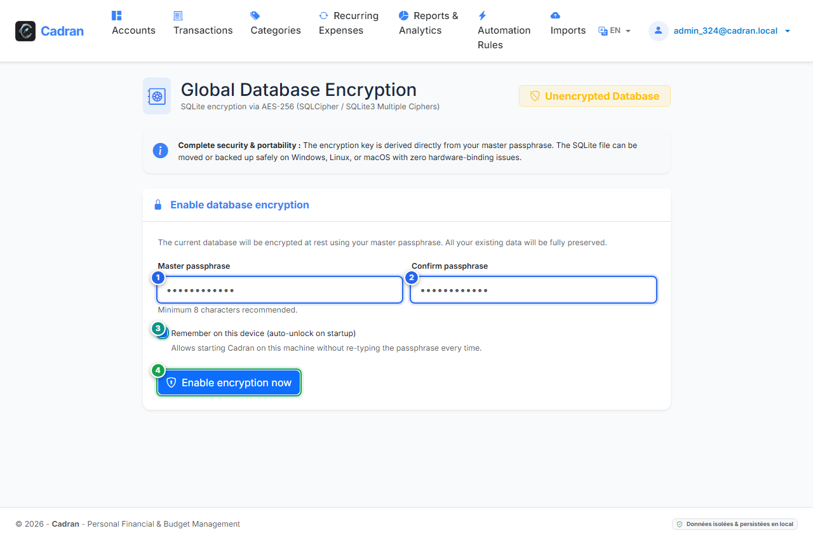

# User Guide: Database Encryption

[← Previous: 03 - Sign In](03-login.md) | [Back to Master Index](../README.md) | [Next: 05 - Cold-Boot Database Unlock →](05-database-unlock.md)

---

The **Database Encryption** screen allows you to lock your local database file with a master passphrase using AES-256 encryption. This ensures no one can read your financial records even if they copy the raw database file from your computer.

---

## 1. Visual Overview & Action Callouts

---

## 2. Action Reference Table

| Marker | UI Element | Action Type | What to do |
| :---: | :--- | :---: | :--- |
| <kbd>1</kbd> | **Master Passphrase** | **FILL IN** | Choose a strong master key (minimum 8 characters). This password will be needed to unlock your database. |
| <kbd>2</kbd> | **Confirm Passphrase** | **FILL IN** | Re-type the exact same master key to confirm. |
| <kbd>3</kbd> | **Remember on device** | **OPTIONAL** | Check this box if you want Cadran to remember the key on this computer so you don't have to type it on every startup. |
| <kbd>4</kbd> | **"Enable encryption"** | **CLICK HERE** | Click this button to encrypt your database file with AES-256 protection. |

---

## 3. Step-by-Step Procedure

1. **Choose your master key**:
   - Type your secret key in **Master passphrase** (**[1]**).
   - Re-type it in **Confirm passphrase** (**[2]**).
2. **Set your startup preference**:
   - Check **Remember on this device** (**[3]**) for convenient auto-unlock on your personal PC.
   - Leave it unchecked if you want Cadran to ask for your master passphrase every time it starts.
3. **Activate**:
   - Click the blue **Enable encryption now** button (**[4]**).
   - Your data is now fully encrypted on disk.

> [!CAUTION]
> If you lose your master passphrase and have not checked "Remember on device", **your data cannot be recovered**. Keep your passphrase in a secure password manager.
