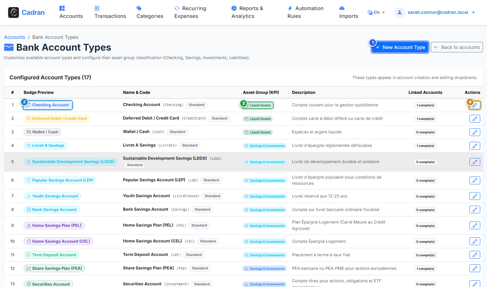

# User Guide: Custom Account Types & Asset Groups

[← Back to Account Ledger](09-account-details.md) | [Next: 11 - Custom Transaction Statuses →](11-account-statuses.md)

---

The **Account Types** screen lets you define and manage how bank accounts are categorized and summarized. Each type maps directly to an asset group (Liquid Assets, Savings & Investments, or Liabilities & Debts), ensuring your net worth is calculated accurately.

---

## 1. Visual Overview & Action Callouts

---

## 2. Action Reference Table

| Marker | UI Element | Action Type | What to do |
| :---: | :--- | :---: | :--- |
| <kbd>1</kbd> | **"New Account Type"** | **CLICK HERE** | Click to open the creation dialog and define a new custom account classification. |
| <kbd>2</kbd> | **Badge Preview** | **SELECT** | Preview the custom color, icon, and display name that appears on account cards. |
| <kbd>3</kbd> | **Asset Group** | **SELECT** | Review or assign the high-level group (**Liquid Assets**, **Savings & Investments**, or **Liabilities / Debts**). |
| <kbd>4</kbd> | **"Edit" Button** | **CLICK HERE** | Click on any row to modify its name, color theme, icon, or asset group association. |

---

## 3. Understanding Asset Classification Groups

Cadran organizes every account into one of three financial asset groups:

1. **Liquid Assets**: High-availability accounts (Checking, Cash, Digital Wallets).
2. **Savings & Investments**: Growth and interest-bearing vehicles (Savings accounts, Equities, Bonds, Crypto).
3. **Liabilities / Debts**: Negative-balance liabilities (Deferred credit cards, Mortgages, Personal loans).

---

## 4. Step-by-Step Procedure

1. **Create a custom type**:
   - Click the blue **New Account Type** button (<kbd>1</kbd>).
   - In the modal dialog, provide a unique name (e.g., `Youth Account`, `Term Deposit`), select a color and an icon, and choose the parent asset group.
2. **Edit an existing type**:
   - Click the pencil **Edit** button (<kbd>4</kbd>) in the table row.
   - Adjust the visual style or group assignment and click save.
