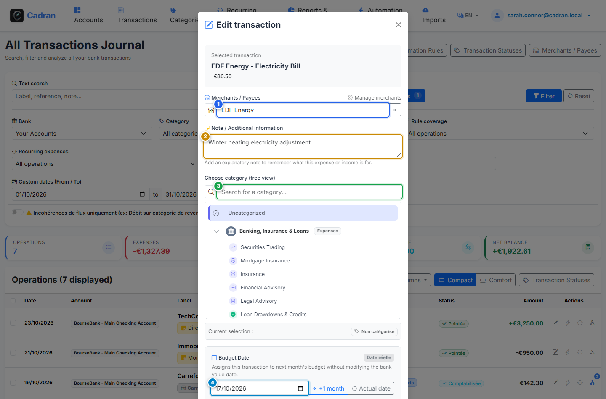

# User Guide: Edit Transaction & Classification Details

[← Previous: 12 - Unified Transaction Ledger](12-transactions-ledger.md) | [← Back to Master Index](../README.md) | [Next: 14 - Split Multi-Category Transactions →](14-split-transaction.md)

---

The **Edit Transaction Modal** allows you to refine transaction metadata, link recognized merchants, set custom accounting notes, and assign expenses to custom budget periods.

---

## 1. Visual Overview & Action Callouts

---

## 2. Action Reference Table

| Marker | UI Element | Action Type | What to do |
| :---: | :--- | :---: | :--- |
| <kbd>1</kbd> | **Merchant Search / Input** | **TYPE / SELECT** | Search for an existing merchant or type a new business name to link this transaction. |
| <kbd>2</kbd> | **Personal Notes & Memo** | **TYPE HERE** | Add free-text context, receipt references, or internal notes regarding the purchase. |
| <kbd>3</kbd> | **Category Explorer Tree** | **CLICK TO EXPAND** | Browse the hierarchical category tree or search by keyword to select the exact category. |
| <kbd>4</kbd> | **Budget Date Override** | **SELECT DATE** | Override the effective budget date when an expense paid late in the month belongs to the next budget. |
| <kbd>5</kbd> | **Custom Status Selector** | **SELECT STATUS** | Choose a custom reconciliation workflow status if configured in your preferences. |
| <kbd>6</kbd> | **"Apply to Similar" Checkbox** | **TOGGLE CHECKBOX** | Check this box to automatically update the category and merchant on all similar past and future transactions. |
| <kbd>7</kbd> | **"Save Changes" Button** | **CLICK HERE** | Save the changes and update the ledger immediately. |

---

## 3. Propagation & Smart Categorization

When you enable **Apply to Similar** (<kbd>6</kbd>):
- The application identifies all other uncategorized operations matching the same normalized merchant label.
- The selected category and merchant link are retroactively and proactively applied, saving time on recurring expenses like subscriptions, utility bills, and grocery stores.

---

## 4. Step-by-Step Instructions

1. **Open the editor**: Click on the category column of any transaction in the ledger.
2. **Assign the merchant**: Type the store or vendor name in field (<kbd>1</kbd>).
3. **Pick the category**: Filter and select the destination category from the tree view (<kbd>3</kbd>).
4. **Attach notes & budget date**: Optionally adjust the budget accounting date (<kbd>4</kbd>) or add notes (<kbd>2</kbd>).
5. **Batch apply rule**: Check (<kbd>6</kbd>) to propagate this classification across all identical transactions.
6. **Save**: Click **Save Changes** (<kbd>7</kbd>).
