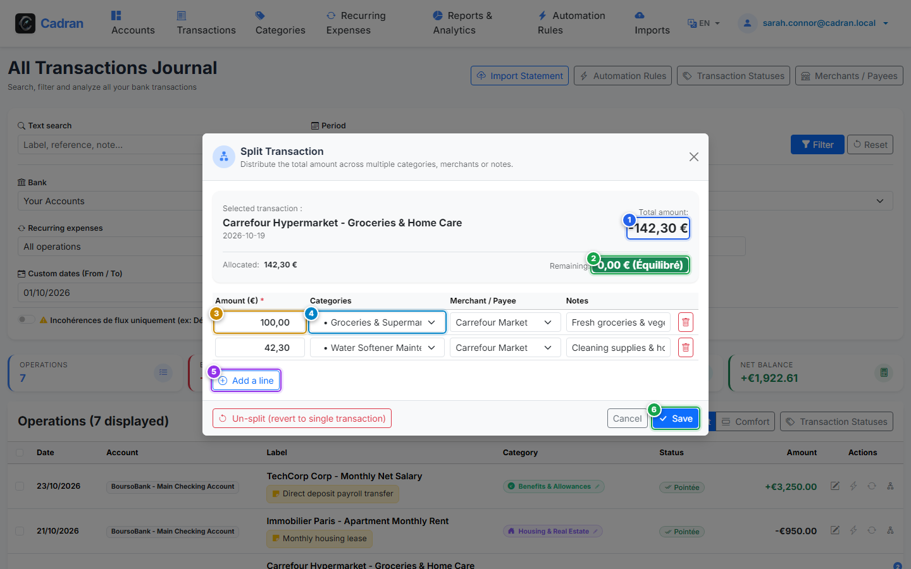

# User Guide: Split Multi-Category Transactions

[← Previous: 13 - Edit Transaction](13-edit-transaction.md) | [← Back to Master Index](../README.md) | [Next: 15 - Batch Reconciliations & Bulk Actions →](15-batch-actions.md)

---

The **Split Transaction Manager** enables you to break down a single receipt or receipt charge into multiple distinct categories and merchants (for instance, a supermarket receipt covering both Food Groceries and Home Maintenance).

---

## 1. Visual Overview & Action Callouts

---

## 2. Action Reference Table

| Marker | UI Element | Action Type | What to do |
| :---: | :--- | :---: | :--- |
| <kbd>1</kbd> | **Total Transaction Amount** | **READ-ONLY DISPLAY** | Displays the full transaction amount that must be matched exactly by the sum of split items. |
| <kbd>2</kbd> | **Remaining Balance Badge** | **STATUS INDICATOR** | Shows the unallocated balance. It turns green when the allocation reaches zero and balances perfectly. |
| <kbd>3</kbd> | **Split Amount Input** | **TYPE AMOUNT** | Enter the exact amount allocated to this specific split line. |
| <kbd>4</kbd> | **Split Category Dropdown** | **SELECT OPTION** | Choose the target category for this portion of the expenditure. |
| <kbd>5</kbd> | **"Add Split Line" Button** | **CLICK HERE** | Add an additional row to divide the expense across more categories. |
| <kbd>6</kbd> | **"Save Splits" Button** | **CLICK HERE** | Commit the split breakdown. Enabled only when the remaining unallocated balance is exactly 0.00. |

---

## 3. Financial Integrity & Zero-Sum Invariant

Cadran enforces strict accounting integrity:
- You cannot save a split transaction if there is any remaining unallocated balance.
- The sum of all split lines must equal the master bank transaction amount.
- In reporting and budgets, the master transaction is replaced by its constituent split items, ensuring budget category charts reflect true spending.

---

## 4. Step-by-Step Instructions

1. **Open the split manager**: Click the split icon on the transaction row or select *Split* from the transaction options.
2. **Set amount for first line**: Enter the amount for the first item (<kbd>3</kbd>) and select its category (<kbd>4</kbd>).
3. **Add additional parts**: Click **Add Split Line** (<kbd>5</kbd>) to insert another line item.
4. **Balance the remainder**: Verify that the **Remaining Balance** indicator (<kbd>2</kbd>) displays `0.00 €` with a green indicator.
5. **Commit**: Click **Save Splits** (<kbd>6</kbd>) to finalize.
