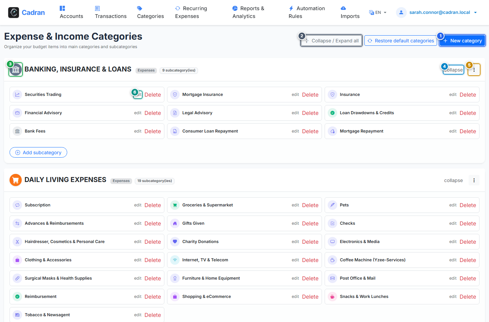

# User Guide: Category Hierarchy & Tree Explorer

[← Previous: 15 - Batch Reconciliations & Bulk Actions](15-batch-actions.md) | [← Back to Master Index](../README.md) | [Next: 17 - Create & Edit Categories →](17-create-category.md)

---

The **Categories Explorer** provides an overview of your spending and income classification structure. It groups your subcategories under main parent groups (e.g., Housing, Food & Dining, Transportation, Utilities) and lets you customize icons, colors, and types.

---

## 1. Visual Overview & Action Callouts

---

## 2. Action Reference Table

| Marker | UI Element | Action Type | What to do |
| :---: | :--- | :---: | :--- |
| <kbd>1</kbd> | **"New Category" Button** | **CLICK HERE** | Open the category creation form to add a new parent group or subcategory. |
| <kbd>2</kbd> | **"Expand / Collapse All" Button** | **CLICK HERE** | Toggle visibility of all subcategory lists across all parent groups at once. |
| <kbd>3</kbd> | **Parent Category Icon & Color** | **VISUAL BADGE** | Identifies the parent group with its assigned Bootstrap icon and hex color code. |
| <kbd>4</kbd> | **Group Collapse / Expand Button** | **CLICK HERE** | Hide or reveal the individual subcategories nested under this specific parent group. |
| <kbd>5</kbd> | **Category Options Menu** | **CLICK HERE** | Open options to edit the parent category or add a subcategory directly under it. |
| <kbd>6</kbd> | **Subcategory Edit Link** | **CLICK HERE** | Click on any subcategory row to edit its label, assigned parent, or icon. |

---

## 3. Category Organization Principles

- **Parent Groups**: High-level spending areas (e.g., *Housing*, *Food & Dining*, *Transportation*).
- **Subcategories**: Granular classification targets (e.g., *Rent*, *Electricity*, *Supermarkets*, *Restaurants*).
- **Income vs Expense**: Each group is tagged as either *Income* (revenues, salaries, dividends) or *Expense* (outgoing purchases and living costs), ensuring accurate budget accounting.

---

## 4. Step-by-Step Instructions

1. **Review your category tree**: Scroll through the groups or click **Expand All** (<kbd>2</kbd>).
2. **Add a custom category**: Click **New Category** (<kbd>1</kbd>).
3. **Edit a subcategory**: Click on any subcategory entry (<kbd>6</kbd>) to adjust its name or color.
4. **Manage a parent group**: Click the options menu (<kbd>5</kbd>) on the group header.
