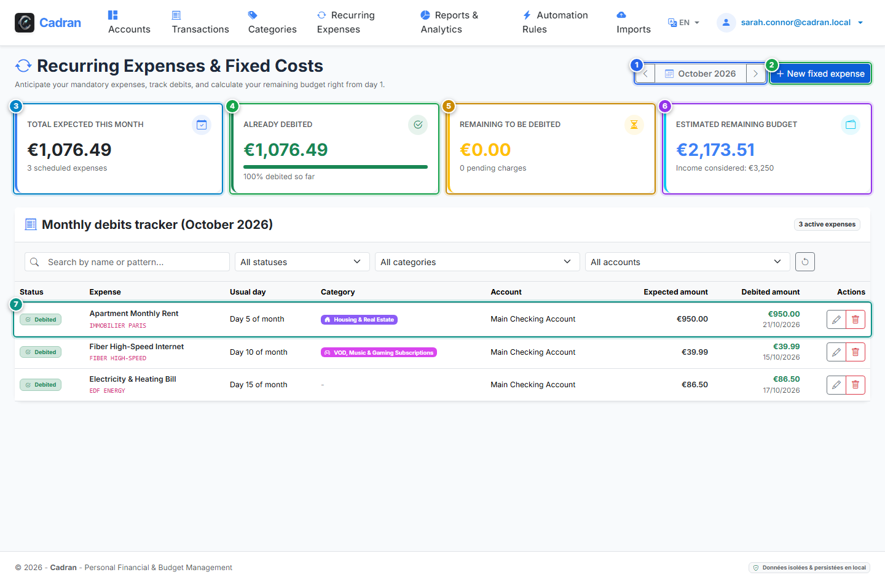

# User Guide: Recurring Operations & Bills Schedule

[← Previous: 18 - Automated Categorization Rules Engine](18-rules-engine.md) | [← Back to Master Index](../README.md) | [Next: 20 - Statement Import (OFX / CSV) →](20-statement-imports.md)

---

The **Recurring Expenses Schedule** tracks your fixed monthly charges, subscriptions, utility bills, and loan payments. It provides a real-time progress view of what has already settled versus what remains pending for the current month, and calculates your true remaining discretionary budget ("reste à vivre").

---

## 1. Visual Overview & Action Callouts

---

## 2. Action Reference Table

| Marker | UI Element | Action Type | What to do |
| :---: | :--- | :---: | :--- |
| <kbd>1</kbd> | **Month Navigation Toolbar** | **CLICK ARROWS** | Switch between past, current, and upcoming calendar months. |
| <kbd>2</kbd> | **"New Expense" Button** | **CLICK HERE** | Open the dialog to add a recurring subscription, rent, or scheduled bill. |
| <kbd>3</kbd> | **Total Expected KPI Card** | **FINANCIAL SUMMARY** | Total budgeted amount of all recurring commitments for the selected month. |
| <kbd>4</kbd> | **Total Debited & Progress Card** | **PROGRESS TRACKER** | Displays settled amount and percentage progress of recurring bills debited so far. |
| <kbd>5</kbd> | **Total Pending KPI Card** | **FINANCIAL SUMMARY** | Sum of commitments still awaiting settlement before the end of the month. |
| <kbd>6</kbd> | **Remaining to Spend KPI Card** | **DISCRETIONARY BUDGET** | Remaining funds calculated after deducting all fixed monthly obligations from your income. |
| <kbd>7</kbd> | **Recurring Line Item** | **INSPECT / EDIT** | Shows bill name, expected amount, payment date, matching status, and edit controls. |

---

## 3. Automated Reconciliation & Detection

- **Pattern Matching**: Each recurring charge includes a keyword pattern (such as `IMMOBILIER PARIS` or `EDF`). When you import statements, Cadran matches matching bank debits automatically and updates the status from *Pending* to *Debited*.
- **Candidate Suggestion**: Cadran scans your transaction history to detect regular bills and suggests adding them as recurring expenses with one click.

---

## 4. Step-by-Step Instructions

1. **Review current month commitments**: Check the KPI cards (<kbd>3</kbd>, <kbd>4</kbd>, <kbd>5</kbd>) to see settled vs pending debits.
2. **Add a new subscription**: Click **New Expense** (<kbd>2</kbd>), set the expected day of the month, amount, and category.
3. **Navigate months**: Use the calendar arrows (<kbd>1</kbd>) to plan future monthly budgets or inspect past months.
4. **Monitor your remaining budget**: Check the **Remaining to Spend** card (<kbd>6</kbd>) to know your safe spending limit.
