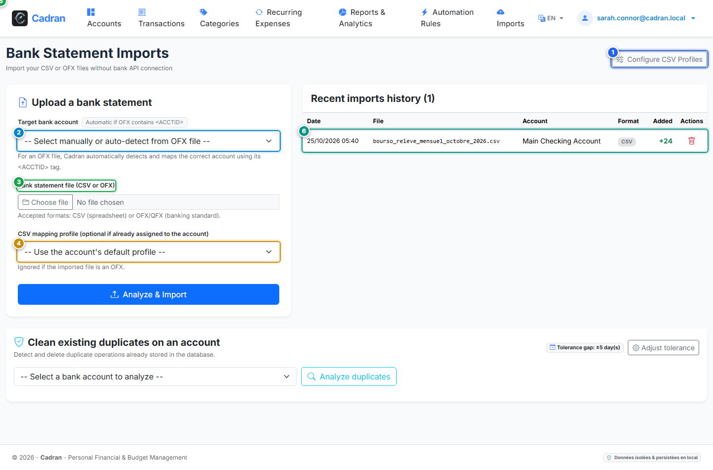

# User Guide: Bank Statement Imports (OFX & CSV)

[← Previous: 19 - Recurring Operations & Bills](19-recurring-transactions.md) | [← Back to Master Index](../README.md) | [Next: 21 - CSV Import Profile Builder →](21-import-mapping.md)

---

The **Bank Statement Importer** allows you to load transaction histories exported from your banking portals in Open Financial Exchange (`.ofx`, `.qfx`) or Delimited (`.csv`, `.tsv`, `.txt`) formats. It features automatic duplicate prevention and triggers your categorization rules automatically.

---

## 1. Visual Overview & Action Callouts

---

## 2. Action Reference Table

| Marker | UI Element | Action Type | What to do |
| :---: | :--- | :---: | :--- |
| <kbd>1</kbd> | **"Configure CSV Profiles" Link** | **CLICK HERE** | Open the CSV profile manager to customize column mapping for banks with non-standard exports. |
| <kbd>2</kbd> | **Target Bank Account** | **SELECT ACCOUNT** | Choose the destination bank account (for OFX files with `<ACCTID>`, Cadran detects this automatically). |
| <kbd>3</kbd> | **"Choose File" Button** | **SELECT FILE** | Browse your local computer to pick your `.csv` or `.ofx` statement file. |
| <kbd>4</kbd> | **CSV Mapping Profile** | **SELECT PROFILE** | Pick a saved column mapping profile (ignored automatically when uploading standard OFX/QFX files). |
| <kbd>5</kbd> | **"Start Import" Button** | **CLICK HERE** | Parse the uploaded file, run duplicate checks, apply rules, and import transactions into the ledger. |
| <kbd>6</kbd> | **Recent Import Batches Audit** | **INSPECT HISTORY** | Review previous imports with timestamps, imported counts, duplicate counts, and auto-categorization scores. |

---

## 3. Duplicate Detection & Financial Integrity

- **OFX Unique IDs**: OFX/QFX files include native `<FITID>` identifiers. Cadran ensures that identical operations are never imported twice.
- **CSV Checksums**: For CSV imports, Cadran calculates an invariant hash combining date, amount, raw label, and account, safely filtering out previously imported transactions.
- **Automatic Rule Application**: As new transactions are parsed, active categorization rules run immediately, classifying expenses before you even open the ledger.

---

## 4. Step-by-Step Instructions

1. **Select the target account**: Pick your checking or savings account in dropdown (<kbd>2</kbd>).
2. **Select your statement file**: Click **Choose File** (<kbd>3</kbd>) and select the exported statement.
3. **Select CSV mapping (if CSV)**: Choose the corresponding bank profile (<kbd>4</kbd>) or leave default for OFX.
4. **Run the import**: Click **Start Import** (<kbd>5</kbd>).
5. **Verify results**: Review the summary banner and history record (<kbd>6</kbd>).
