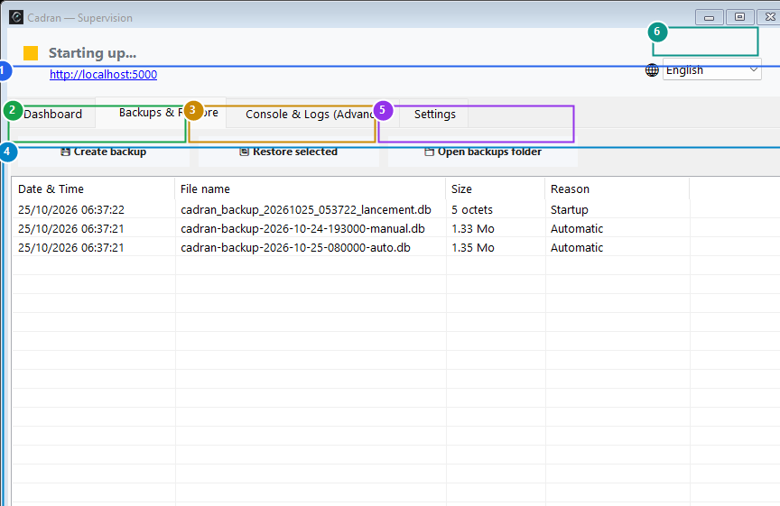

# User Guide: Windows Tray Launcher & Automated Backups

[← Previous: 23 - Appearance & Theme Settings](23-appearance-settings.md) | [← Back to Master Index](../README.md)

---

The **Cadran Tray Launcher** manages the background web server, monitors process health, and automates database backups and retention policies with zero data loss. It resides in your Windows system tray near the clock.

---

## 1. Visual Overview & Action Callouts

---

## 2. Action Reference Table

| Marker | UI Element | Action Type | What to do |
| :---: | :--- | :---: | :--- |
| <kbd>1</kbd> | **Main Supervision Tabs** | **CLICK TAB** | Switch between Server Dashboard, Backups & Restore, Real-Time Console Logs, and Settings. |
| <kbd>2</kbd> | **"Create Backup Now" Button** | **CLICK HERE** | Trigger an immediate atomic snapshot of your SQLite / SQLCipher database. |
| <kbd>3</kbd> | **"Restore Selected Backup" Button** | **CLICK HERE** | Revert your financial database to the selected backup point. |
| <kbd>4</kbd> | **Backups History List** | **INSPECT / SELECT** | Review snapshot dates, filenames, file sizes, and triggers (Scheduled, Pre-import, Manual). |
| <kbd>5</kbd> | **"Open Backups Folder" Button** | **CLICK HERE** | Open the physical backups folder in Windows File Explorer for external copying. |
| <kbd>6</kbd> | **Interface Language Dropdown** | **SELECT LANGUAGE** | Instantly switch launcher language between English, French, Spanish, and German. |

---

## 3. Automated Backup Strategies & Retention

Cadran guarantees that your financial data is always protected:
- **Startup & Shutdown Snapshots**: An automatic backup is created every time the supervisor starts and before closing.
- **Pre-Import Checkpoints**: Before processing an external OFX or CSV statement, a rollback checkpoint is automatically saved.
- **Retention Policy**: Cadran automatically prunes old snapshots based on your chosen limits (e.g., retain the last 30 snapshots or last 90 days), preventing disk clutter.

---

## 4. Step-by-Step Instructions

1. **Access the supervisor**: Double-click the Cadran icon in your Windows notification tray (near the clock).
2. **Take a manual backup**: Switch to the **Backups** tab (<kbd>1</kbd>) and click **Create Backup Now** (<kbd>2</kbd>).
3. **Restore a past state**: Select any backup row from the list (<kbd>4</kbd>) and click **Restore Selected Backup** (<kbd>3</kbd>).
4. **Export backups to external storage**: Click **Open Backups Folder** (<kbd>5</kbd>) and copy the files to your external drive or NAS.
